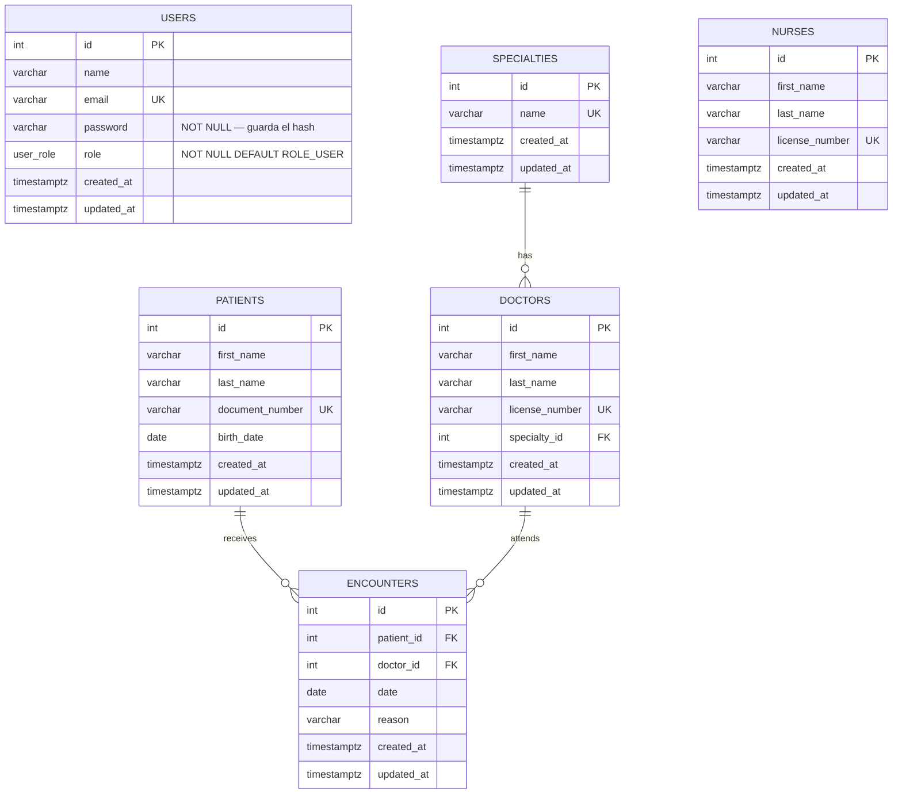

<div align="center">

<a href="https://nodejs.org/en" target="_blank"></a>

# Clase 8 de NodeJS

### Kopius · The Academy · Cohort 05 · M3

**API REST: nuevos recursos, modelos con Sequelize, OpenAPI, Swagger UI y pruebas**


</div>

---

## CONTENIDO

1. [Resumen y siguientes pasos](#1-resumen-y-siguientes-pasos)
2. [MVP y alcance](#2-mvp-y-alcance)
3. [Modelo del dominio](#3-modelo-del-dominio)
   - [Las entidades](#31-las-entidades)
   - [Decisiones de diseño](#32-decisiones-de-diseño)
   - [DER y relaciones](#33-der-y-relaciones)
   - [Del DER a Sequelize](#34-del-der-a-sequelize)
4. [Rutas REST](#4-rutas-rest)
5. [Modelos con Sequelize y tablas desde el ORM](#5-modelos-con-sequelize-y-tablas-desde-el-orm)
   - [Por qué sync y no DDL a mano](#51-por-qué-sync-y-no-ddl-a-mano)
   - [Estructura de modelos](#52-estructura-de-modelos)
   - [El modelo Specialty](#53-el-modelo-specialty)
   - [El modelo Patient](#54-el-modelo-patient)
   - [El modelo Doctor](#55-el-modelo-doctor)
   - [El modelo Nurse](#56-el-modelo-nurse)
   - [El modelo Encounter](#57-el-modelo-encounter)
   - [Asociaciones, foreign keys y onDelete](#58-asociaciones-foreign-keys-y-ondelete)
   - [El índice de modelos](#59-el-índice-de-modelos)
   - [Crear las tablas: sync](#510-crear-las-tablas-sync)
   - [sync, alter y force](#511-sync-alter-y-force)
   - [De Sequelize a HTTP](#512-de-sequelize-a-http)
6. [OpenAPI](#6-openapi)
   - [Qué documentar](#61-qué-documentar)
   - [El archivo openapi.yaml](#62-el-archivo-openapiyaml)
   - [Validar el documento](#63-validar-el-documento)
7. [Swagger UI](#7-swagger-ui)
   - [Instalación](#71-instalación)
   - [Montarlo en Express](#72-montarlo-en-express)
   - [Por qué /docs y /openapi.yaml](#73-por-qué-docs-y-openapiyaml)
8. [Arquitectura](#8-arquitectura)
9. [Tarea 014: MVP hospitalario documentado y probado](#9-tarea-014-mvp-hospitalario-documentado-y-probado)
   - [Objetivo](#91-objetivo)
   - [Entregables](#92-entregables)
   - [Estructura esperada](#93-estructura-esperada)
   - [Paso a paso](#94-paso-a-paso)
   - [Pruebas manuales con Postman](#95-pruebas-manuales-con-postman)
   - [Tests automatizados: investigación](#96-tests-automatizados-investigación)
   - [Criterios de aceptación](#97-criterios-de-aceptación)
   - [Desafíos](#98-desafíos)
   - [Errores frecuentes](#99-errores-frecuentes)
10. [Referencias](#10-referencias)

---

> [!NOTE]
> Esta clase no reescribe lo que ya hiciste: lo **extiende**. La API de usuarios de la Clase 7 sigue funcionando igual. Lo nuevo son cuatro recursos (pacientes, médicos, enfermeros y atenciones), un catálogo de especialidades y una tabla que relaciona pacientes con médicos, las tablas creadas desde el ORM, el contrato en OpenAPI, la documentación navegable en Swagger UI y dos capas de prueba: manual con Postman y automatizada en código.

## 1. Resumen y siguientes pasos

En la Clase 7 construiste una API de usuarios con `Route → Middleware → Controller → Model`, Sequelize y PostgreSQL. No fue un ejercicio suelto: es el esqueleto mínimo de cualquier backend real, y cada pieza que aprendiste vuelve a aparecer en esta clase.

**Lo que ya sabés hacer**

| Concepto             | Qué resolviste                                                 | Dónde reaparece                                           |
| -------------------- | -------------------------------------------------------------- | --------------------------------------------------------- |
| Modelo relacional    | Tablas, filas, PK, FK, `UNIQUE`, `NOT NULL` e integridad       | El DER, las restricciones y la FK `doctors → specialties` |
| SQL                  | DDL, DML, `SELECT`, `JOIN`, agregaciones, índices              | Entender y auditar el SQL que el ORM genera               |
| PostgreSQL en Docker | Contenedor con volumen, conexión desde TablePlus               | La misma base, más una segunda base para los tests        |
| ORM: Sequelize       | Conexión con _fail fast_, modelo `User`, operaciones básicas   | Cinco modelos nuevos y sus asociaciones                   |
| Modelo vs DTO        | Qué valida el modelo y qué valida el DTO                       | La misma frontera, replicada en cuatro recursos           |
| DTO con Yup          | Validación de entrada, DTO de salida, todos los errores juntos | Los cuerpos de paciente, médico y enfermero               |
| Middlewares          | Validar body, validar id, 404, manejo central de errores       | Los mismos, con dos errores nuevos de Sequelize           |
| Patrón clásico       | `Route → Middleware → Controller → Model`                      | Se replica por recurso sin inventar otra arquitectura     |
| Persistencia real    | Datos que sobreviven al reinicio del proceso y del contenedor  | El criterio de "está terminado" del MVP                   |
| Pruebas con `curl`   | Verificar a mano el contrato de la API                         | Escalar a Postman y a tests automatizados                 |

Con esto **no te falta ningún concepto nuevo** para dar el salto. Lo que falta es otra cosa: aplicar las mismas piezas a un dominio más grande, hacer explícitas las relaciones entre tablas y sumar dos capas que la Clase 7 no tenía —el contrato escrito y la prueba automatizada—. Eso es lo que separa un CRUD de laboratorio de un proyecto que se puede mostrar.

Por eso esta clase deja de ser un ejercicio de una tabla y pasa a ser el **MVP de un sistema hospitalario**: el proyecto donde cada pieza de la Clase 7 se usa porque el dominio la necesita. La base relacional, el ORM, los DTO y los middlewares no aparecen porque el docente los pidió; aparecen porque hay pacientes, médicos y enfermeros que administrar. El alcance exacto está en [2. MVP y alcance](#2-mvp-y-alcance).

**Qué cambia, concretamente**

| Pieza                 | Clase 7                                  | Clase 8                                                      |
| --------------------- | ---------------------------------------- | ------------------------------------------------------------ |
| Recursos              | `users`                                  | `patients`, `doctors`, `nurses`, `specialties` + `users`     |
| Tablas                | DDL escrito a mano en TablePlus          | Generadas por Sequelize (`sync`)                             |
| Relaciones            | Ninguna: una tabla suelta                | `specialty_id` con `FOREIGN KEY` y asociaciones del ORM      |
| Contrato              | Lo que el código hacía                   | `docs/openapi.yaml` como fuente de verdad de la interfaz     |
| Documentación         | README del repo                          | Swagger UI en `/docs` leyendo el contrato                    |
| Pruebas               | `curl`                                   | Colección de Postman + tests automatizados                   |
| Errores               | `VALIDATION_ERROR`, `EMAIL_TAKEN`, `404` | Los mismos, más `409` por documento/matrícula y `400` por FK |
| Cantidad de endpoints | 7                                        | 33 (26 nuevos)                                               |

> [!IMPORTANT]
> "Siguiente nivel" no significa "otra API". Significa que el mismo proyecto crece: mismos middlewares, mismo formato de error, mismo DTO de salida. Si tenés que reescribir la mitad de `users` para agregar `patients`, el diseño anterior estaba mal separado.

Tres ideas ordenan toda la clase:

| Idea                                  | Qué resuelve                                                                       |
| ------------------------------------- | ---------------------------------------------------------------------------------- |
| **El ORM define el esquema**          | Una sola definición (el modelo) produce la tabla, sus columnas y sus restricciones |
| **El contrato es un archivo**         | `openapi.yaml` describe la API; Swagger UI solo lo dibuja                          |
| **Una prueba manual no es una suite** | Postman explora el contrato; los tests lo protegen contra regresiones              |

<sub>[⬆ Volver al índice](#contenido)</sub>

---

## 2. MVP y alcance

Un **MVP** (producto mínimo viable) es el conjunto más chico de funcionalidad que valida el flujo completo de punta a punta. No es "la mitad de la app": es la versión que ya sirve para algo real y que se puede mostrar sin pedir disculpas.

El flujo que esta clase tiene que poder demostrar es este:

```text
1. Existe un catálogo de especialidades
2. Se registra un médico en una especialidad
3. Se registra un paciente
4. Se registra un enfermero
5. Se registra una atención que vincula un paciente con un médico
6. Se consultan, actualizan y eliminan los cuatro recursos
7. Se buscan atenciones por paciente, por médico y por fecha
8. Todo queda en PostgreSQL y sobrevive a reiniciar el proceso
9. Todo está descrito en /docs
10. Todo está cubierto por pruebas
```

Si ese recorrido funciona completo, el MVP está cerrado. Todo lo demás es alcance posterior.

| Recurso        | Operaciones                                                           | Estado  |
| -------------- | --------------------------------------------------------------------- | ------- |
| Pacientes      | crear, listar, buscar, actualizar, eliminar                           | Nuevo   |
| Médicos        | crear, listar, buscar, actualizar, eliminar                           | Nuevo   |
| Enfermeros     | crear, listar, buscar, actualizar, eliminar                           | Nuevo   |
| Atenciones     | crear, listar, actualizar, eliminar, buscar por paciente/médico/fecha | Nuevo   |
| Especialidades | listar (catálogo de solo lectura)                                     | Nuevo   |
| Usuarios       | crear, listar, buscar, actualizar, eliminar                           | Clase 7 |

**Qué queda afuera, y por qué**

| Fuera del alcance          | Motivo                                                                                                      |
| -------------------------- | ----------------------------------------------------------------------------------------------------------- |
| Login y autorización       | Requiere usuarios con credenciales; se ve más adelante en el curso                                          |
| Turnos y agenda            | Un turno es lo **agendado**; una atención es lo que **ocurrió**. La agenda pide calendario y disponibilidad |
| Historia clínica detallada | Diagnóstico, receta y evolución son datos sensibles: exigen auditoría, cifrado y retención                  |
| Edición del catálogo       | Las especialidades se siembran; alcanza con leerlas en este MVP                                             |

> [!WARNING]
> Es un ejercicio educativo. Datos clínicos reales exigen normativa, auditoría, cifrado, privacidad, retención y controles que quedan fuera del alcance de la materia.

> [!NOTE]
> El catálogo de especialidades y la tabla de atenciones entran al MVP porque **sin relaciones reales no hay DER que explicar ni asociaciones que practicar**. La primera es 1:N; la segunda convierte el vínculo paciente–médico en una entidad con fecha y motivo propios.

<sub>[⬆ Volver al índice](#contenido)</sub>

---

## 3. Modelo del dominio

### 3.1 Las entidades

Seis tablas. Cinco se crean en esta clase; `users` ya existe.

**`specialties`** — el catálogo de áreas médicas.

| Campo        | Tipo          | Restricción          | Por qué                                  |
| ------------ | ------------- | -------------------- | ---------------------------------------- |
| `id`         | `INTEGER`     | PK                   | Identidad de la fila                     |
| `name`       | `VARCHAR(80)` | `NOT NULL`, `UNIQUE` | "Cardiología" no puede existir dos veces |
| `created_at` | `TIMESTAMPTZ` | `NOT NULL`           | Auditoría mínima                         |
| `updated_at` | `TIMESTAMPTZ` | `NOT NULL`           | Auditoría mínima                         |

**`patients`** — la persona que recibe atención.

| Campo                     | Tipo           | Restricción          | Por qué                                               |
| ------------------------- | -------------- | -------------------- | ----------------------------------------------------- |
| `id`                      | `INTEGER`      | PK                   | Identidad                                             |
| `first_name`              | `VARCHAR(120)` | `NOT NULL`           | Se busca por apellido; no es un blob de texto         |
| `last_name`               | `VARCHAR(120)` | `NOT NULL`           | Ídem                                                  |
| `document_number`         | `VARCHAR(20)`  | `NOT NULL`, `UNIQUE` | Es la identidad real del paciente: no puede repetirse |
| `birth_date`              | `DATE`         | `NOT NULL`           | Se guarda la fecha, no un timestamp                   |
| `created_at`/`updated_at` | `TIMESTAMPTZ`  | `NOT NULL`           | Auditoría                                             |

**`doctors`** — el profesional que atiende, con una especialidad.

| Campo                     | Tipo           | Restricción                       | Por qué                               |
| ------------------------- | -------------- | --------------------------------- | ------------------------------------- |
| `id`                      | `INTEGER`      | PK                                | Identidad                             |
| `first_name`              | `VARCHAR(120)` | `NOT NULL`                        | —                                     |
| `last_name`               | `VARCHAR(120)` | `NOT NULL`                        | —                                     |
| `license_number`          | `VARCHAR(20)`  | `NOT NULL`, `UNIQUE`              | La matrícula es única por profesional |
| `specialty_id`            | `INTEGER`      | `NOT NULL`, FK → `specialties.id` | Un médico **tiene** una especialidad  |
| `created_at`/`updated_at` | `TIMESTAMPTZ`  | `NOT NULL`                        | Auditoría                             |

**`nurses`** — el profesional de enfermería.

| Campo                     | Tipo           | Restricción          | Por qué                                       |
| ------------------------- | -------------- | -------------------- | --------------------------------------------- |
| `id`                      | `INTEGER`      | PK                   | Identidad                                     |
| `first_name`              | `VARCHAR(120)` | `NOT NULL`           | —                                             |
| `last_name`               | `VARCHAR(120)` | `NOT NULL`           | —                                             |
| `license_number`          | `VARCHAR(20)`  | `NOT NULL`, `UNIQUE` | Misma regla que el médico, en su propia tabla |
| `created_at`/`updated_at` | `TIMESTAMPTZ`  | `NOT NULL`           | Auditoría                                     |

**`encounters`** — la atención: qué paciente, qué médico, qué día y por qué.

| Campo                     | Tipo           | Restricción                    | Por qué                                |
| ------------------------- | -------------- | ------------------------------ | -------------------------------------- |
| `id`                      | `INTEGER`      | PK                             | Identidad                              |
| `patient_id`              | `INTEGER`      | `NOT NULL`, FK → `patients.id` | Quién recibió la atención              |
| `doctor_id`               | `INTEGER`      | `NOT NULL`, FK → `doctors.id`  | Quién la brindó                        |
| `date`                    | `DATE`         | `NOT NULL`                     | Es la dimensión de búsqueda y de orden |
| `reason`                  | `VARCHAR(255)` | `NOT NULL`                     | Sin motivo, la fila no explica nada    |
| `created_at`/`updated_at` | `TIMESTAMPTZ`  | `NOT NULL`                     | Auditoría                              |

Un paciente puede tener muchas atenciones —con el mismo médico o con distintos—; un médico, muchas con distintos pacientes. Esa es la relación N:M que el documento base dejaba para después, resuelta con una **entidad que tiene atributos propios**: la fecha y el motivo pertenecen al vínculo, no a ninguna de las dos puntas.

**`users`** — ya existe desde la Clase 7. `id`, `name`, `email` (`UNIQUE`), `password VARCHAR(255) NOT NULL` (guarda el hash, nunca el texto plano), `role user_role NOT NULL DEFAULT 'ROLE_USER'` y los timestamps. `user_role` es un ENUM nativo de PostgreSQL con dos valores: `ROLE_USER` y `ROLE_ADMIN`.

### 3.2 Decisiones de diseño

Cinco decisiones que conviene poder defender en voz alta.

**1. `specialty` deja de ser un texto y pasa a ser una tabla.**

El documento base menciona `Doctor(..., specialty)`. Guardar `"Cardiología"` como string funciona hasta que alguien escribe `"cardiologia"`, `"Cardiologia "` o `"Cardio"` y el filtro deja de encontrar nada. La solución es la misma que estudiaste en normalización: **un dato que se repite se convierte en una fila de otra tabla y se referencia por clave**.

| Antes (string)                             | Ahora (FK)                                  |
| ------------------------------------------ | ------------------------------------------- |
| Se repite el nombre en cada médico         | Vive una sola vez en `specialties`          |
| Un typo crea una especialidad fantasma     | La FK impide referenciar algo que no existe |
| Cambiar el nombre exige un `UPDATE` masivo | Se actualiza una fila                       |
| No hay forma de listar las especialidades  | `GET /api/specialties` sale gratis          |

**2. `document_number` y `license_number` son `VARCHAR`, no `INTEGER`.**

Un documento de identidad es un **identificador**, no un número con el que se opera. Tiene ceros a la izquierda, puede tener letras y nunca se suma. Guardarlo como entero borra información (`"030111222"` se convierte en `30111222`) y rompe el día que aparece un documento alfanumérico. Misma lógica para la matrícula.

**3. `birth_date` es `DATE`, no `TIMESTAMP`.**

Nadie nace "a las 14:03 UTC". `DATEONLY` en Sequelize produce una columna `DATE` en PostgreSQL y devuelve `"1985-12-10"` como string: sin hora, sin zona horaria y sin el clásico bug de "cumpleaños que se corre un día" al serializar. El contrato viaja en ISO 8601 (`YYYY-MM-DD`).

**4. Enfermeros no tiene especialidad ni atenciones (todavía).**

`nurses` queda sin FK a propósito. Podría tener un área, pero **no la pide nadie en este MVP** y agregar una tabla que ningún endpoint usa es deuda, no diseño. Tampoco participa de `encounters`: las atenciones de este MVP son paciente ↔ médico. Cuando enfermería entre al dominio, aparecerá otra relación —y ese día se decide con el dominio, no por simetría—. Modelar de menos y decirlo es más profesional que modelar de más y no poder justificarlo.

**5. La atención es una entidad, no una tabla pivote.**

Una tabla pivote solo guarda dos claves foráneas. `encounters` guarda además **fecha y motivo**, y esos datos pertenecen al vínculo, no al paciente ni al médico. Eso cambia el código, no solo el diagrama:

| Si fuera pivote                           | Siendo entidad                                             |
| ----------------------------------------- | ---------------------------------------------------------- |
| `belongsToMany` con `through`             | Dos `belongsTo` y dos `hasMany`, con modelo propio         |
| No tendría ruta ni contrato propio        | Tiene CRUD, DTO, validación y endpoints propios            |
| Se borra con cualquiera de las dos puntas | `ON DELETE RESTRICT` en ambas FK: la atención no se pierde |
| No se puede buscar por fecha              | `date` es columna de primera clase y se indexa             |

> [!IMPORTANT]
> `date` es `DATE`, no `TIMESTAMP`. Una atención ocurrió **un día**; la hora exacta no la pide ningún caso de este MVP y agregarla obliga a decidir zona horaria. Si mañana la agenda necesita horarios, se agrega una columna nueva con su migración, no se reinterpreta la existente.

> [!NOTE]
> `RESTRICT` en las dos FK de `encounters` significa algo concreto para el usuario de la API: `DELETE /api/patients/{id}` y `DELETE /api/doctors/{id}` responden `409` cuando esa persona tiene atenciones registradas. No es un bug: es la base negándose a borrar historia clínica.

> [!IMPORTANT]
> Cada `UNIQUE` es una regla de negocio escrita una sola vez, en el lugar donde nadie la puede saltear. Si la unicidad vive solo en un `if` del controller, dos peticiones simultáneas pueden pasar las dos.

### 3.3 DER y relaciones

**DER** (Diagrama Entidad-Relación) es la foto del esquema: qué tablas existen, qué columnas tienen y cómo se conectan. Se lee de las claves: la **PK** identifica, la **FK** referencia y la **UK** garantiza unicidad.



**Cómo leerlo**

| Símbolo    | Significado                                                       |
| ---------- | ----------------------------------------------------------------- |
| `PK`       | Primary key: identifica la fila, única y no nula                  |
| `FK`       | Foreign key: referencia la PK de otra tabla                       |
| `UK`       | Unique key: no admite repetidos, pero puede cambiar               |
| `\|\|--o{` | Uno a cero-o-muchos: una especialidad tiene cero o muchos médicos |

**Las relaciones, en palabras**

| Relación                  | Cardinalidad | Regla                                                                                                      |
| ------------------------- | ------------ | ---------------------------------------------------------------------------------------------------------- |
| `specialties` → `doctors` | 1 : N        | Una especialidad agrupa muchos médicos; un médico pertenece a una                                          |
| `patients` → `encounters` | 1 : N        | Un paciente tiene cero o muchas atenciones; cada atención tiene un paciente                                |
| `doctors` → `encounters`  | 1 : N        | Un médico tiene cero o muchas atenciones; cada atención tiene un médico                                    |
| `patients` ↔ `doctors`    | N : M        | **A través de `encounters`.** No es una relación directa: siempre pasa por una atención con fecha y motivo |
| `nurses` ↔ todo           | —            | Independiente en este MVP                                                                                  |
| `users` ↔ todo            | —            | Independiente. El rol existe, pero la autorización real todavía no: en la Clase 7 se simuló con un header  |

> [!NOTE]
> `password`, `role` y `user_role` vienen del desafío 7.6 de la Clase 7. La columna se llama `password` igual que el campo del JSON, pero **guarda el hash**: el DTO es la frontera donde el valor cambia de significado. El rol es un ENUM nativo de PostgreSQL (`ROLE_USER`, `ROLE_ADMIN`) con `DEFAULT 'ROLE_USER'`.

> [!WARNING]
> `password` **no** se documenta en OpenAPI ni se devuelve en ninguna respuesta. Documentar el modelo crudo es la forma más rápida de filtrar un hash: el schema `User` del contrato se escribe a mano, con `id`, `name`, `email` y `role` —nunca con `password`.

> [!TIP]
> `ON DELETE` es parte del modelo, no un detalle del ORM. Con `RESTRICT`, borrar una especialidad que tiene médicos **falla**, y eso es correcto: el motor te está avisando que dejarías datos huérfanos. En `encounters` la misma regla protege algo más valioso: no se borra un paciente ni un médico que tenga atenciones registradas. Con `CASCADE` borrarías historia clínica sin que nadie lo pidiera.

### 3.4 Del DER a Sequelize

El diagrama se escribe una vez y se traduce a código una vez. Esta es la correspondencia:

| En el DER             | En Sequelize                                                           | En PostgreSQL                                  |
| --------------------- | ---------------------------------------------------------------------- | ---------------------------------------------- |
| Tabla                 | `Model.init(..., { tableName: "patients" })`                           | `patients`                                     |
| Columna `first_name`  | atributo `firstName` + `underscored: true`                             | `first_name`                                   |
| `int id PK`           | `primaryKey: true, autoIncrement: true`                                | `SERIAL` / `IDENTITY`                          |
| `varchar(120)`        | `DataTypes.STRING(120)`                                                | `VARCHAR(120)`                                 |
| `date`                | `DataTypes.DATEONLY`                                                   | `DATE`                                         |
| `timestamptz`         | `timestamps: true` (automático)                                        | `created_at`, `updated_at`                     |
| `UK`                  | `unique: true`                                                         | `UNIQUE` (índice único)                        |
| `FK specialty_id`     | `Doctor.belongsTo(Specialty, { foreignKey: "specialtyId" })`           | `FOREIGN KEY ... REFERENCES`                   |
| `1 : N`               | `hasMany` en un lado, `belongsTo` en el otro                           | La FK vive en el lado "muchos"                 |
| `N : M` con atributos | Un modelo propio (`Encounter`) con dos `belongsTo`, no `belongsToMany` | Tabla intermedia con dos FK y columnas propias |

> [!NOTE]
> `hasMany` **no** crea nada por sí solo: declara la relación en el ORM para que puedas hacer `include` y para que `sync` sepa en qué orden crear las tablas y dónde poner la FK. La columna existe porque `belongsTo` la declara.

<sub>[⬆ Volver al índice](#contenido)</sub>

---

## 4. Rutas REST

Los cuatro recursos nuevos repiten exactamente el patrón de `users`. Nada de rutas nuevas con otro estilo: la API tiene que sentirse como una sola.

```http
GET    /api/patients
GET    /api/patients/search?keywords=lovelace
GET    /api/patients/{id}
POST   /api/patients
PATCH  /api/patients/{id}
DELETE /api/patients/{id}
```

`doctors` y `nurses` son idénticos cambiando el sustantivo. `specialties` expone solo lectura:

```http
GET    /api/specialties
GET    /api/specialties/{id}
```

Las atenciones tienen CRUD completo, pero la búsqueda no es por palabra clave: es por **paciente, médico o fecha**, con filtros combinables.

```http
GET    /api/encounters
GET    /api/encounters/search?patientId=1
GET    /api/encounters/search?doctorId=2
GET    /api/encounters/search?date=2026-11-20
GET    /api/encounters/search?patientId=1&date=2026-11-20
GET    /api/encounters/{id}
POST   /api/encounters
PATCH  /api/encounters/{id}
DELETE /api/encounters/{id}
```

| Filtro      | Tipo      | Regla                                             |
| ----------- | --------- | ------------------------------------------------- |
| `patientId` | `integer` | Positivo. Si no existe, devuelve `data: []`       |
| `doctorId`  | `integer` | Positivo. Si no existe, devuelve `data: []`       |
| `date`      | `date`    | `YYYY-MM-DD`. Se compara contra la columna `date` |

Los tres son opcionales y se combinan con `AND`. Sin filtros, `/search` devuelve la colección completa ordenada por fecha descendente.

> [!IMPORTANT]
> Los query params llegan **como string**, siempre. `?patientId=abc` no es un número y `?date=20-11-2026` no es ISO 8601. Validalos con un DTO de query (Yup + un middleware `validateQuery`) antes de tocar el modelo: si un `NaN` llega al `where`, la consulta falla con un error de base y el cliente recibe `500` en lugar de `400`.

> [!NOTE]
> `/search` va declarado **antes** de `/:id`, igual que en `users`. Si invertís el orden, `GET /api/encounters/search` entra por el validador de id y responde `INVALID_ID`.

**Tabla completa de la API después de esta clase**

| Método   | Path                     | Éxito | Errores esperados                       |
| -------- | ------------------------ | ----- | --------------------------------------- |
| `GET`    | `/api/health`            | `200` | —                                       |
| `GET`    | `/api/users`             | `200` | —                                       |
| `GET`    | `/api/users/search`      | `200` | —                                       |
| `GET`    | `/api/users/{id}`        | `200` | `400` `INVALID_ID`, `404`               |
| `POST`   | `/api/users`             | `201` | `400`, `409`                            |
| `PATCH`  | `/api/users/{id}`        | `200` | `400`, `404`, `409`                     |
| `DELETE` | `/api/users/{id}`        | `204` | `400`, `404`                            |
| `GET`    | `/api/patients`          | `200` | —                                       |
| `GET`    | `/api/patients/search`   | `200` | —                                       |
| `GET`    | `/api/patients/{id}`     | `200` | `400`, `404`                            |
| `POST`   | `/api/patients`          | `201` | `400`, `409`                            |
| `PATCH`  | `/api/patients/{id}`     | `200` | `400`, `404`, `409`                     |
| `DELETE` | `/api/patients/{id}`     | `204` | `400`, `404`, `409` si tiene atenciones |
| `GET`    | `/api/doctors`           | `200` | —                                       |
| `GET`    | `/api/doctors/search`    | `200` | —                                       |
| `GET`    | `/api/doctors/{id}`      | `200` | `400`, `404`                            |
| `POST`   | `/api/doctors`           | `201` | `400`, `409`                            |
| `PATCH`  | `/api/doctors/{id}`      | `200` | `400`, `404`, `409`                     |
| `DELETE` | `/api/doctors/{id}`      | `204` | `400`, `404`, `409` si tiene atenciones |
| `GET`    | `/api/nurses`            | `200` | —                                       |
| `GET`    | `/api/nurses/search`     | `200` | —                                       |
| `GET`    | `/api/nurses/{id}`       | `200` | `400`, `404`                            |
| `POST`   | `/api/nurses`            | `201` | `400`, `409`                            |
| `PATCH`  | `/api/nurses/{id}`       | `200` | `400`, `404`, `409`                     |
| `DELETE` | `/api/nurses/{id}`       | `204` | `400`, `404`                            |
| `GET`    | `/api/encounters`        | `200` | —                                       |
| `GET`    | `/api/encounters/search` | `200` | `400` si un filtro es inválido          |
| `GET`    | `/api/encounters/{id}`   | `200` | `400`, `404`                            |
| `POST`   | `/api/encounters`        | `201` | `400` paciente o médico inexistente     |
| `PATCH`  | `/api/encounters/{id}`   | `200` | `400`, `404`, `409`                     |
| `DELETE` | `/api/encounters/{id}`   | `204` | `400`, `404`                            |
| `GET`    | `/api/specialties`       | `200` | —                                       |
| `GET`    | `/api/specialties/{id}`  | `200` | `400`, `404`                            |

**Formato de respuesta**

Colección:

```json
{
  "data": [
    {
      "id": 1,
      "firstName": "Ada",
      "lastName": "Lovelace",
      "documentNumber": "30111222",
      "birthDate": "1985-12-10"
    }
  ]
}
```

Detalle de un médico, con la relación resuelta:

```json
{
  "data": {
    "id": 1,
    "firstName": "Gregory",
    "lastName": "House",
    "licenseNumber": "MN-88421",
    "specialty": { "id": 2, "name": "Diagnóstico clínico" }
  }
}
```

Detalle de una atención, con las dos puntas resueltas:

```json
{
  "data": {
    "id": 1,
    "date": "2026-11-20",
    "reason": "Control de presión arterial",
    "patient": { "id": 1, "firstName": "Ada", "lastName": "Lovelace" },
    "doctor": { "id": 1, "firstName": "Gregory", "lastName": "House" }
  }
}
```

Error:

```json
{
  "error": {
    "code": "DOCUMENT_NUMBER_TAKEN",
    "message": "Document number is already registered"
  }
}
```

> [!IMPORTANT]
> El cuerpo de un médico **no** expone `specialtyId` suelto y además el objeto anidado. Elegí una forma y sostenela en el contrato: acá la forma canónica es `specialty: { id, name }` porque es la que el cliente consume sin una segunda llamada. La entrada, en cambio, recibe `specialtyId` porque es lo que el cliente conoce.

> [!IMPORTANT]
> La atención devuelve **referencias mínimas**: `patient` y `doctor` con `id`, `firstName` y `lastName`, no las entidades completas. Un `include` sin `attributes` trae todas las columnas de las dos tablas en cada fila de la colección. Proyectá lo que el cliente necesita con `include: [{ model: Patient, as: "patient", attributes: ["id", "firstName", "lastName"] }]`.

> [!WARNING]
> `DELETE /api/patients/{id}` sobre un paciente con atenciones responde `409 PATIENT_HAS_ENCOUNTERS`. No lo resuelvas cambiando `RESTRICT` por `CASCADE` "para que pase la prueba": estarías borrando atenciones que nadie pidió borrar. Si el negocio quiere permitirlo, es una decisión explícita y se documenta.

> [!WARNING]
> No copies controladores cambiando nombres con buscar-y-reemplazar. Copiá la **estructura** y adaptá las reglas. Si dos recursos comparten literalmente el mismo cuerpo, extraé una utilidad; si comparten la forma pero no las reglas, no lo hagas. Una abstracción prematura esconde el dominio y después no sabés dónde vive qué.

<sub>[⬆ Volver al índice](#contenido)</sub>

---

## 5. Modelos con Sequelize y tablas desde el ORM

### 5.1 Por qué sync y no DDL a mano

En la Clase 7 escribiste el `CREATE TABLE` en TablePlus y después reflejaste eso en un modelo. Son dos fuentes de verdad y se desincronizan: agregás una columna en el modelo, olvidás el `ALTER`, y la API falla con `column does not exist`.

Acá invertimos la dirección:

```text
Modelo (JavaScript)  →  Sequelize  →  CREATE TABLE / ALTER TABLE  →  PostgreSQL
        una definición                    DDL generado                  esquema real
```

Ventajas concretas para esta etapa:

| Ventaja                            | Detalle                                                       |
| ---------------------------------- | ------------------------------------------------------------- |
| Una sola fuente de verdad          | El modelo declara tipo, nulabilidad, unicidad y FK            |
| El esquema se reproduce desde cero | `npm run db:reset` y tenés la base igual en cualquier máquina |
| Las FK y los índices no se olvidan | Salen de las asociaciones y de `unique: true`                 |
| El equipo no depende de TablePlus  | El repo alcanza para levantar el entorno                      |

Costos que hay que decir en voz alta:

| Costo                                     | Consecuencia                                                   |
| ----------------------------------------- | -------------------------------------------------------------- |
| `sync` **no versiona** cambios            | No sabés qué cambió entre dos despliegues                      |
| `alter: true` puede ser destructivo       | Renombra o dropea columnas sin preguntar                       |
| No sirve para producción con datos reales | Para eso existen las **migraciones** (próxima etapa del curso) |

> [!IMPORTANT]
> `sync` es una herramienta de desarrollo y de educación. En producción, el esquema se cambia con migraciones versionadas, revisadas y reversibles. Esta clase usa `sync` porque el objetivo es entender el modelo, no operar una base con datos de clientes.

### 5.2 Estructura de modelos

Cada tabla es un archivo, cada archivo exporta una clase, y un índice importa todo y declara las asociaciones.

```text
src/models/
├── index.js            ← importa todo + declara asociaciones
├── user.model.js       ← Clase 7, no se toca
├── specialty.model.js
├── patient.model.js
├── doctor.model.js
└── nurse.model.js
```

Todos los modelos arrancan igual: imports, `class X extends Model {}`, `X.init(...)`.

```javascript
import { DataTypes, Model } from "sequelize";
import { sequelize } from "../config/database.js";

export class Patient extends Model {}

Patient.init(
  {
    /* columnas */
  },
  {
    sequelize,
    modelName: "Patient",
    tableName: "patients",
    underscored: true,
    timestamps: true,
  },
);
```

> [!NOTE]
> `sequelize` ya declara `define: { underscored: true, timestamps: true }` en `config/database.js` (lo hiciste en la Clase 7). Repetirlo en cada modelo es redundante, pero explícito: si mañana alguien usa otra instancia, el modelo no cambia de forma. Elegí una convención y sostenela.

### 5.3 El modelo Specialty

```javascript
import { DataTypes, Model } from "sequelize";
import { sequelize } from "../config/database.js";

export class Specialty extends Model {}

Specialty.init(
  {
    id: {
      type: DataTypes.INTEGER,
      primaryKey: true,
      autoIncrement: true,
    },
    name: {
      type: DataTypes.STRING(80),
      allowNull: false,
      unique: true,
      validate: {
        notEmpty: { msg: "Specialty name cannot be empty" },
        len: {
          args: [3, 80],
          msg: "Specialty name must be between 3 and 80 characters",
        },
      },
    },
  },
  {
    sequelize,
    modelName: "Specialty",
    tableName: "specialties",
    underscored: true,
    timestamps: true,
  },
);
```

| Línea               | Qué hace                                                |
| ------------------- | ------------------------------------------------------- |
| `unique: true`      | Crea un índice único en la base, no solo una validación |
| `validate.notEmpty` | Rechaza `""` y `"   "` antes de llegar al motor         |
| `validate.len`      | Rechaza nombres absurdos con un mensaje legible         |

> [!WARNING]
> `unique: true` genera `SequelizeUniqueConstraintError`, **no** `SequelizeValidationError`. Si solo mapeaste el segundo en el `errorHandler`, un duplicado va a salir como `500`. Lo resolvemos en [5.12](#512-de-sequelize-a-http).

### 5.4 El modelo Patient

```javascript
import { DataTypes, Model } from "sequelize";
import { sequelize } from "../config/database.js";

export class Patient extends Model {}

Patient.init(
  {
    id: {
      type: DataTypes.INTEGER,
      primaryKey: true,
      autoIncrement: true,
    },
    firstName: {
      type: DataTypes.STRING(120),
      allowNull: false,
      validate: {
        notEmpty: { msg: "First name cannot be empty" },
        len: {
          args: [2, 120],
          msg: "First name must be between 2 and 120 characters",
        },
      },
    },
    lastName: {
      type: DataTypes.STRING(120),
      allowNull: false,
      validate: {
        notEmpty: { msg: "Last name cannot be empty" },
        len: {
          args: [2, 120],
          msg: "Last name must be between 2 and 120 characters",
        },
      },
    },
    documentNumber: {
      type: DataTypes.STRING(20),
      allowNull: false,
      unique: true,
      validate: {
        notEmpty: { msg: "Document number cannot be empty" },
        is: {
          args: /^[0-9]{7,10}$/,
          msg: "Document number must contain 7 to 10 digits",
        },
      },
    },
    birthDate: {
      type: DataTypes.DATEONLY,
      allowNull: false,
      validate: {
        isDate: { msg: "Birth date must be a valid date (YYYY-MM-DD)" },
        isBefore: {
          args: new Date().toISOString().slice(0, 10),
          msg: "Birth date must be in the past",
        },
      },
    },
  },
  {
    sequelize,
    modelName: "Patient",
    tableName: "patients",
    underscored: true,
    timestamps: true,
  },
);
```

| Decisión                    | Por qué                                                                 |
| --------------------------- | ----------------------------------------------------------------------- |
| `documentNumber` string     | Los ceros a la izquierda y las letras son parte del identificador       |
| `unique: true`              | Un documento duplicado es un error de negocio, no un warning            |
| `DATEONLY`                  | Se guarda `DATE` y vuelve `"1985-12-10"`, sin hora ni zona horaria      |
| `isBefore` con fecha de hoy | Un paciente que nace mañana es un error de tipeo, no un caso de negocio |

> [!TIP]
> `isBefore` se evalúa al construir la instancia. Si un test crea la fecha "de hoy" y corre justo después de medianoche, puede fallar por un día. Para el ejercicio alcanza; en un sistema real esa validación va en el DTO con la fecha del request.

### 5.5 El modelo Doctor

Acá aparece la primera FK del curso.

```javascript
import { DataTypes, Model } from "sequelize";
import { sequelize } from "../config/database.js";

export class Doctor extends Model {}

Doctor.init(
  {
    id: {
      type: DataTypes.INTEGER,
      primaryKey: true,
      autoIncrement: true,
    },
    firstName: {
      type: DataTypes.STRING(120),
      allowNull: false,
      validate: {
        notEmpty: { msg: "First name cannot be empty" },
        len: {
          args: [2, 120],
          msg: "First name must be between 2 and 120 characters",
        },
      },
    },
    lastName: {
      type: DataTypes.STRING(120),
      allowNull: false,
      validate: {
        notEmpty: { msg: "Last name cannot be empty" },
        len: {
          args: [2, 120],
          msg: "Last name must be between 2 and 120 characters",
        },
      },
    },
    licenseNumber: {
      type: DataTypes.STRING(20),
      allowNull: false,
      unique: true,
      validate: {
        notEmpty: { msg: "License number cannot be empty" },
        len: {
          args: [4, 20],
          msg: "License number must be between 4 and 20 characters",
        },
      },
    },
    specialtyId: {
      type: DataTypes.INTEGER,
      allowNull: false,
      field: "specialty_id",
      references: {
        model: "specialties",
        key: "id",
      },
    },
  },
  {
    sequelize,
    modelName: "Doctor",
    tableName: "doctors",
    underscored: true,
    timestamps: true,
    indexes: [{ fields: ["specialty_id"] }],
  },
);
```

| Detalle                 | Por qué                                                                    |
| ----------------------- | -------------------------------------------------------------------------- |
| `field: "specialty_id"` | Deja explícito el nombre de la columna, más allá de `underscored`          |
| `references`            | Documenta en el modelo a qué tabla y columna apunta                        |
| `allowNull: false`      | Un médico sin especialidad no entra al MVP                                 |
| `indexes`               | Filtrar por especialidad es la consulta más probable; el índice la acelera |

> [!IMPORTANT]
> `references` **no crea** la FK por sí solo cuando usás `sync` sobre modelos ya inicializados con asociaciones. La que manda es la asociación (`belongsTo`) de [5.8](#58-asociaciones-foreign-keys-y-ondelete). `references` sirve como documentación y para `sync` en algunos escenarios. Declará las dos y olvidate del problema.

### 5.6 El modelo Nurse

Igual que `Doctor`, sin FK. La única diferencia real es la tabla y el `modelName`.

```javascript
import { DataTypes, Model } from "sequelize";
import { sequelize } from "../config/database.js";

export class Nurse extends Model {}

Nurse.init(
  {
    id: {
      type: DataTypes.INTEGER,
      primaryKey: true,
      autoIncrement: true,
    },
    firstName: {
      type: DataTypes.STRING(120),
      allowNull: false,
      validate: {
        notEmpty: { msg: "First name cannot be empty" },
        len: {
          args: [2, 120],
          msg: "First name must be between 2 and 120 characters",
        },
      },
    },
    lastName: {
      type: DataTypes.STRING(120),
      allowNull: false,
      validate: {
        notEmpty: { msg: "Last name cannot be empty" },
        len: {
          args: [2, 120],
          msg: "Last name must be between 2 and 120 characters",
        },
      },
    },
    licenseNumber: {
      type: DataTypes.STRING(20),
      allowNull: false,
      unique: true,
      validate: {
        notEmpty: { msg: "License number cannot be empty" },
        len: {
          args: [4, 20],
          msg: "License number must be between 4 and 20 characters",
        },
      },
    },
  },
  {
    sequelize,
    modelName: "Nurse",
    tableName: "nurses",
    underscored: true,
    timestamps: true,
  },
);
```

### 5.7 El modelo Encounter

La tabla que convierte el vínculo paciente–médico en una entidad.

```javascript
import { DataTypes, Model } from "sequelize";
import { sequelize } from "../config/database.js";

export class Encounter extends Model {}

Encounter.init(
  {
    id: {
      type: DataTypes.INTEGER,
      primaryKey: true,
      autoIncrement: true,
    },
    patientId: {
      type: DataTypes.INTEGER,
      allowNull: false,
      field: "patient_id",
      references: { model: "patients", key: "id" },
    },
    doctorId: {
      type: DataTypes.INTEGER,
      allowNull: false,
      field: "doctor_id",
      references: { model: "doctors", key: "id" },
    },
    date: {
      type: DataTypes.DATEONLY,
      allowNull: false,
      validate: {
        isDate: { msg: "Date must be a valid date (YYYY-MM-DD)" },
      },
    },
    reason: {
      type: DataTypes.STRING(255),
      allowNull: false,
      validate: {
        notEmpty: { msg: "Reason cannot be empty" },
        len: {
          args: [3, 255],
          msg: "Reason must be between 3 and 255 characters",
        },
      },
    },
  },
  {
    sequelize,
    modelName: "Encounter",
    tableName: "encounters",
    underscored: true,
    timestamps: true,
    indexes: [
      { fields: ["patient_id"] },
      { fields: ["doctor_id"] },
      { fields: ["date"] },
    ],
  },
);
```

| Detalle                        | Por qué                                                                 |
| ------------------------------ | ----------------------------------------------------------------------- |
| Dos FK `allowNull: false`      | Una atención sin paciente o sin médico no es una atención               |
| `DATEONLY`                     | Se busca por día, no por instante; evita el corrimiento de zona horaria |
| `indexes` en las tres columnas | Las búsquedas del MVP son exactamente por paciente, médico o fecha      |
| Sin `unique`                   | El mismo paciente puede volver con el mismo médico el mismo día         |
| Sin `belongsToMany`            | La tabla tiene datos propios: se modela como entidad, no como pivote    |

> [!IMPORTANT]
> `reason` en `VARCHAR(255)` es el **motivo** de la consulta, no el diagnóstico. Un campo llamado `diagnosis` convertiría esta tabla en historia clínica, con todo lo que eso exige y que está fuera del alcance.

### 5.8 Asociaciones, foreign keys y onDelete

Una relación se declara en los **dos** lados. No es duplicación: es la misma relación vista desde cada extremo. Sin el `belongsTo`, no podés hacer `include`; sin el `hasMany`, no podés preguntar "los médicos de esta especialidad".

```javascript
// src/models/index.js

Specialty.hasMany(Doctor, {
  foreignKey: { name: "specialtyId", allowNull: false },
  as: "doctors",
  onDelete: "RESTRICT",
  onUpdate: "CASCADE",
});

Doctor.belongsTo(Specialty, {
  foreignKey: { name: "specialtyId", allowNull: false },
  as: "specialty",
  onDelete: "RESTRICT",
  onUpdate: "CASCADE",
});

Patient.hasMany(Encounter, {
  foreignKey: { name: "patientId", allowNull: false },
  as: "encounters",
  onDelete: "RESTRICT",
  onUpdate: "CASCADE",
});

Encounter.belongsTo(Patient, {
  foreignKey: { name: "patientId", allowNull: false },
  as: "patient",
  onDelete: "RESTRICT",
  onUpdate: "CASCADE",
});

Doctor.hasMany(Encounter, {
  foreignKey: { name: "doctorId", allowNull: false },
  as: "encounters",
  onDelete: "RESTRICT",
  onUpdate: "CASCADE",
});

Encounter.belongsTo(Doctor, {
  foreignKey: { name: "doctorId", allowNull: false },
  as: "doctor",
  onDelete: "RESTRICT",
  onUpdate: "CASCADE",
});
```

| Opción                 | Qué controla                                                            |
| ---------------------- | ----------------------------------------------------------------------- |
| `foreignKey.name`      | El atributo que existe en el lado "muchos" (`patientId` → `patient_id`) |
| `foreignKey.allowNull` | Si la fila puede quedar sin esa relación                                |
| `as`                   | El alias que usás en `include`; **tiene que coincidir** con el DTO      |
| `onDelete: RESTRICT`   | Impide borrar la fila padre si tiene hijas                              |
| `onUpdate: CASCADE`    | Si cambia la PK, se propaga (raro, pero correcto)                       |

> [!NOTE]
> `Doctor.hasMany(Encounter, { as: "encounters" })` y `Encounter.belongsTo(Doctor, { as: "doctor" })` usan alias distintos a propósito: desde el médico la colección se llama `encounters`; desde la atención, la punta se llama `doctor`. El alias de cada lado describe lo que ese lado ve.

**Qué significa cada `ON DELETE`**

| Valor       | Comportamiento                                         | Cuándo usarlo                                |
| ----------- | ------------------------------------------------------ | -------------------------------------------- |
| `RESTRICT`  | Falla si hay filas que referencian                     | Catálogos que no deben perder integridad     |
| `NO ACTION` | Igual que `RESTRICT`, chequea al final de la sentencia | Default de PostgreSQL                        |
| `CASCADE`   | Borra las filas hijas                                  | Cuando el hijo no tiene sentido sin el padre |
| `SET NULL`  | Deja la FK en `NULL` (requiere columna nulable)        | Relación opcional                            |

> [!WARNING]
> Si ves una columna llamada `specialtyId` con mayúscula en la base, `underscored` no está activo en ese modelo. Sequelize respeta el nombre tal cual si la conversión no está habilitada.

> [!NOTE]
> Los alias (`as`) son la causa número uno de `EagerLoadingError: specialty is not associated to doctor!`. Si el error aparece, revisá dos cosas: que `models/index.js` se haya importado antes de la consulta, y que el alias del `include` sea exactamente el del `belongsTo`.

### 5.9 El índice de modelos

Un solo archivo importa todos los modelos y declara las asociaciones. Es el punto de entrada que usan la app, los scripts y los tests.

```javascript
// src/models/index.js
import { sequelize } from "../config/database.js";
import { User } from "./user.model.js";
import { Specialty } from "./specialty.model.js";
import { Patient } from "./patient.model.js";
import { Doctor } from "./doctor.model.js";
import { Nurse } from "./nurse.model.js";
import { Encounter } from "./encounter.model.js";

Specialty.hasMany(Doctor, {
  foreignKey: { name: "specialtyId", allowNull: false },
  as: "doctors",
  onDelete: "RESTRICT",
  onUpdate: "CASCADE",
});

Doctor.belongsTo(Specialty, {
  foreignKey: { name: "specialtyId", allowNull: false },
  as: "specialty",
  onDelete: "RESTRICT",
  onUpdate: "CASCADE",
});

Patient.hasMany(Encounter, {
  foreignKey: { name: "patientId", allowNull: false },
  as: "encounters",
  onDelete: "RESTRICT",
  onUpdate: "CASCADE",
});

Encounter.belongsTo(Patient, {
  foreignKey: { name: "patientId", allowNull: false },
  as: "patient",
  onDelete: "RESTRICT",
  onUpdate: "CASCADE",
});

Doctor.hasMany(Encounter, {
  foreignKey: { name: "doctorId", allowNull: false },
  as: "encounters",
  onDelete: "RESTRICT",
  onUpdate: "CASCADE",
});

Encounter.belongsTo(Doctor, {
  foreignKey: { name: "doctorId", allowNull: false },
  as: "doctor",
  onDelete: "RESTRICT",
  onUpdate: "CASCADE",
});

export { sequelize, User, Specialty, Patient, Doctor, Nurse, Encounter };
```

**Regla de oro:** si un controlador necesita un modelo, lo importa de `index.js`, nunca del archivo del modelo. Así las asociaciones siempre están declaradas.

**Bien**

```javascript
import { Doctor, Specialty } from "../models/index.js";
```

**Mal: el modelo existe, pero la asociación puede no estar declarada**

```javascript
import { Doctor } from "../models/doctor.model.js";
```

> [!WARNING]
> Importar un modelo directamente no rompe nada _hoy_, pero rompe el día que agregues una asociación y el `include` explote según el orden de imports. Es un bug de los peores: depende de quién cargó primero.

### 5.10 Crear las tablas: sync

Dos scripts chicos y tres comandos de npm.

```javascript
// scripts/db-sync.js
import { sequelize } from "../models/index.js";

const force = process.argv.includes("--force");

if (force) {
  console.warn("⚠️  --force: se van a borrar TODAS las tablas y sus datos");
}

try {
  await sequelize.sync({ force });
  console.log("✅ Schema synchronized");
  await sequelize.close();
} catch (error) {
  console.error("❌ Unable to synchronize the schema");
  console.error(error);
  process.exitCode = 1;
  await sequelize.close();
}
```

```javascript
// scripts/db-seed.js
import { sequelize, Specialty } from "../models/index.js";

const SPECIALTIES = [
  { name: "Cardiología" },
  { name: "Pediatría" },
  { name: "Clínica médica" },
  { name: "Diagnóstico clínico" },
  { name: "Traumatología" },
];

try {
  await sequelize.sync(); // idempotente: crea solo lo que falta
  await Specialty.bulkCreate(SPECIALTIES, { ignoreDuplicates: true });
  console.log(`✅ Specialties seeded: ${SPECIALTIES.length}`);
  await sequelize.close();
} catch (error) {
  console.error("❌ Unable to seed specialties");
  console.error(error);
  process.exitCode = 1;
  await sequelize.close();
}
```

```json
{
  "scripts": {
    "dev": "node --watch src/server.js",
    "start": "node src/server.js",
    "db:sync": "node scripts/db-sync.js",
    "db:seed": "node scripts/db-seed.js",
    "db:reset": "node scripts/db-sync.js --force && node scripts/db-seed.js"
  }
}
```

| Comando            | Qué hace                                         |
| ------------------ | ------------------------------------------------ |
| `npm run db:sync`  | Crea las tablas que faltan. No borra nada        |
| `npm run db:seed`  | Carga el catálogo de especialidades sin duplicar |
| `npm run db:reset` | Borra todo, recrea el esquema y vuelve a sembrar |

> [!IMPORTANT]
> `sync` crea las tablas en orden de dependencia: primero `specialties`, después `doctors`. Si la FK falla, es porque las asociaciones no se declararon antes de llamar a `sync`. Importar `models/index.js` resuelve el orden.

> [!TIP]
> `bulkCreate(..., { ignoreDuplicates: true })` genera un `ON CONFLICT DO NOTHING`. El seed se puede correr dos veces seguidas sin romper nada. Un seed que falla la segunda vez es un seed que no sirve para el día a día.

### 5.11 sync, alter y force

Tres modos que conviene distinguir antes de destruir la base de un compañero.

| Modo                    | Qué hace                                         | Cuándo usarlo                      |
| ----------------------- | ------------------------------------------------ | ---------------------------------- |
| `sync()`                | Crea lo que falta. No modifica lo existente      | Arranque normal en desarrollo      |
| `sync({ alter: true })` | Compara y aplica `ALTER` para alinear el esquema | Prototipo, con la base descartable |
| `sync({ force: true })` | `DROP TABLE` de todo y lo recrea                 | Reset explícito, nunca automático  |

**Por qué `alter: true` es peligroso:** compara modelo y base y aplica cambios con `ALTER`. Si renombrás un atributo, para Sequelize es "borrar la columna y crear otra": los datos de esa columna desaparecen. No hay confirmación ni rollback.

**Por qué no sincronizar al arrancar el servidor:** con más de una instancia, dos procesos pelean por el mismo `ALTER`. Y un cambio de modelo se aplicaría solo al desplegar, sin revisión ni registro. Por eso el `sync` va en un script que se corre a propósito.

> [!WARNING]
> `npm run db:reset` **borra los datos**. No lo agregues como paso del arranque ni de los tests de otro recurso. Si lo necesitás para probar, decilo en voz alta antes de ejecutarlo.

### 5.12 De Sequelize a HTTP

El `errorHandler` de la Clase 7 tiene que aprender dos errores nuevos. Sin esto, un duplicado y una FK inexistente salen como `500`.

```javascript
// src/middlewares/error.middleware.js (fragmento)
import {
  ForeignKeyConstraintError,
  UniqueConstraintError,
  ValidationError as SequelizeValidationError,
} from "sequelize";

const UNIQUE_CODES = {
  document_number: "DOCUMENT_NUMBER_TAKEN",
  license_number: "LICENSE_NUMBER_TAKEN",
  name: "SPECIALTY_NAME_TAKEN",
  email: "EMAIL_TAKEN",
};

export const errorHandler = (error, req, res, next) => {
  if (error instanceof UniqueConstraintError) {
    const field = Object.keys(error.fields ?? {})[0];
    const code = UNIQUE_CODES[field] ?? "DUPLICATE_VALUE";

    return res.status(409).json({
      error: { code, message: "Value is already registered" },
    });
  }

  if (error instanceof ForeignKeyConstraintError) {
    return res.status(400).json({
      error: {
        code: "INVALID_REFERENCE",
        message: "Referenced resource does not exist",
      },
    });
  }

  if (error instanceof SequelizeValidationError) {
    return res.status(400).json({
      error: {
        code: "VALIDATION_ERROR",
        message: "Invalid request body",
        details: error.errors.map((item) => item.message),
      },
    });
  }

  next(error);
};
```

| Error                               | HTTP           | Ejemplo                                             |
| ----------------------------------- | -------------- | --------------------------------------------------- |
| `UniqueConstraintError`             | `409`          | `POST /api/patients` con un documento que ya existe |
| `ForeignKeyConstraintError`         | `400`          | `POST /api/encounters` con `patientId: 999`         |
| `SequelizeValidationError`          | `400`          | `birthDate: "mañana"`                               |
| `AppError` (tu clase de la Clase 7) | el que declare | `404` `PATIENT_NOT_FOUND`                           |

**El mismo error de Sequelize, dos significados HTTP**

`ForeignKeyConstraintError` aparece en dos situaciones opuestas y no se resuelven igual:

| Operación                               | Qué significa                                    | HTTP  | Código                   |
| --------------------------------------- | ------------------------------------------------ | ----- | ------------------------ |
| `POST`/`PATCH` con una FK que no existe | El cuerpo referencia algo inexistente            | `400` | `INVALID_REFERENCE`      |
| `DELETE` de una fila que tiene hijas    | La fila está en uso; borrarla deja historia rota | `409` | `PATIENT_HAS_ENCOUNTERS` |

El `errorHandler` global se queda con el `400`, porque no conoce el recurso. El `409` se traduce en el **controller**, que sí sabe qué está borrando:

```javascript
// src/controllers/patient.controller.js (fragmento)
import { ForeignKeyConstraintError } from "sequelize";
import { AppError } from "../errors/app-error.js";
import { Patient } from "../models/index.js";

export const deletePatient = async (req, res) => {
  const patient = await Patient.findByPk(req.resourceId);

  if (!patient) {
    throw new AppError("Patient not found", {
      status: 404,
      code: "PATIENT_NOT_FOUND",
    });
  }

  try {
    await patient.destroy();
  } catch (error) {
    if (error instanceof ForeignKeyConstraintError) {
      throw new AppError("Patient has encounters and cannot be deleted", {
        status: 409,
        code: "PATIENT_HAS_ENCOUNTERS",
      });
    }

    throw error;
  }

  res.status(204).end();
};
```

> [!IMPORTANT]
> No uses `req.method` dentro del `errorHandler` para adivinar el significado. El handler global no sabe qué recurso falló ni qué regla se rompió; el controller sí. Cada `409` con nombre propio (`PATIENT_HAS_ENCOUNTERS`, `DOCTOR_HAS_ENCOUNTERS`) se escribe donde vive la regla.

> [!NOTE]
> `error.fields` devuelve **nombres de columna** de la base (`document_number`), no atributos del modelo (`documentNumber`). Si el código no coincide, agregá un `console.log(error.fields)` temporal, verificá el string exacto y borralo. Es debug normal, no magia.

**`include` en el controlador**

```javascript
// src/controllers/doctor.controller.js (fragmento)
import { Doctor, Specialty } from "../models/index.js";
import { toDoctorResponse } from "../dtos/doctor.dto.js";

const withSpecialty = { model: Specialty, as: "specialty" };

export const listDoctors = async (req, res) => {
  const doctors = await Doctor.findAll({
    include: withSpecialty,
    order: [["id", "ASC"]],
  });

  res.json({ data: doctors.map(toDoctorResponse) });
};

export const getDoctorById = async (req, res) => {
  const doctor = await Doctor.findByPk(req.resourceId, {
    include: withSpecialty,
  });

  if (!doctor) {
    throw new AppError("Doctor not found", {
      status: 404,
      code: "DOCTOR_NOT_FOUND",
    });
  }

  res.json({ data: toDoctorResponse(doctor) });
};

export const createDoctor = async (req, res) => {
  const doctor = await Doctor.create(req.dto);
  await doctor.reload({ include: withSpecialty });

  res
    .status(201)
    .location(`/api/doctors/${doctor.id}`)
    .json({ data: toDoctorResponse(doctor) });
};
```

Factores de integridad que sostienen todo esto:

| Regla                               | Dónde vive                         |
| ----------------------------------- | ---------------------------------- |
| El documento no se repite           | `UNIQUE` en la base                |
| La especialidad referenciada existe | `FOREIGN KEY` en la base           |
| El body tiene forma válida          | Yup, en el middleware              |
| El modelo nunca se expone crudo     | DTO de salida                      |
| Un `409` no se convierte en `500`   | Mapa de errores del `errorHandler` |

> [!IMPORTANT]
> `doctor.reload({ include })` existe porque `create` devuelve la fila sin las asociaciones cargadas. Sin el `reload`, el `POST` respondería `specialty: undefined` y el contrato de OpenAPI mentiría en el primer endpoint que documentaste.

<sub>[⬆ Volver al índice](#contenido)</sub>

---

## 6. OpenAPI

**OpenAPI** es una especificación para describir APIs HTTP en un archivo (YAML o JSON). Describe paths, operaciones, parámetros, cuerpos, respuestas, códigos de error y esquemas, en un formato que las herramientas pueden leer.

No es documentación escrita a mano en un README. Es un **contrato legible por máquinas**: de ahí salen los clientes, los mocks, los tests de contrato y la UI.

| Concepto       | Qué es                                                     |
| -------------- | ---------------------------------------------------------- |
| OpenAPI        | La especificación del contrato                             |
| Swagger        | El ecosistema de herramientas alrededor de OpenAPI         |
| Swagger UI     | La página que **renderiza** el contrato y permite probarlo |
| Swagger Editor | El editor para escribir el contrato                        |

Usamos **OpenAPI 3.2.1**, la versión vigente al preparar el material. Los documentos 3.1.x siguen siendo válidos: si una herramienta de tu cadena no entiende 3.2, cambiá la línea `openapi:` y listo, el diseño no cambia.

### 6.1 Qué documentar

La regla es simple y no admite excepciones: **si el endpoint existe, está documentado.** No solo el feliz.

| Obligatorio         | Detalle                                                                                                   |
| ------------------- | --------------------------------------------------------------------------------------------------------- |
| Las 33 operaciones  | Health (1), `users` (6), `patients` (6), `doctors` (6), `nurses` (6), `encounters` (6), `specialties` (2) |
| Esquemas de entrada | Un schema por body posible (`PatientInput`, `DoctorInput`…)                                               |
| Esquemas de salida  | Lo que realmente se devuelve, con el anidamiento incluido                                                 |
| Códigos de error    | `400`, `404`, `409` con el schema de error común                                                          |
| Ejemplos            | Al menos un ejemplo por schema y por respuesta                                                            |
| Tags                | Agrupar por recurso para que la UI no sea una lista plana                                                 |
| `operationId`       | Único por operación; lo usan los generadores de clientes                                                  |

> [!IMPORTANT]
> Documentar lo que **querés** que pase no es documentar. Si el `POST /api/doctors` devuelve `specialty: null` porque te olvidaste el `reload`, el contrato tiene que decir eso (o el código tiene que arreglarse). Un contrato que miente es peor que no tener contrato.

### 6.2 El archivo openapi.yaml

Este es el esqueleto completo y **válido**: health, el CRUD de pacientes y la búsqueda de atenciones, más todos los componentes reutilizables. Los otros recursos se documentan copiando la forma.

```yaml
openapi: 3.2.1
info:
  title: Hospital API
  summary: Pacientes, médicos, enfermeros, atenciones y especialidades
  description: |
    API REST del curso. Los recursos de `users` vienen de la Clase 7.
  version: 1.0.0
servers:
  - url: http://localhost:3000
    description: Local

# Sin autenticación en este MVP: se declara explícito, no se deja implícito.
security: []

tags:
  - name: Health
    description: Estado del servicio
  - name: Users
    description: Usuarios de la Clase 7
  - name: Patients
    description: Pacientes
  - name: Doctors
    description: Médicos y su especialidad
  - name: Nurses
    description: Enfermeros
  - name: Encounters
    description: Atenciones entre un paciente y un médico
  - name: Specialties
    description: Catálogo de especialidades (solo lectura)

paths:
  /api/health:
    get:
      tags: [Health]
      summary: Health check
      operationId: getHealth
      responses:
        "200":
          description: API is up
          content:
            application/json:
              schema:
                type: object
                required: [status]
                properties:
                  status:
                    type: string
                    examples: [ok]

  /api/patients:
    get:
      tags: [Patients]
      summary: List patients
      operationId: listPatients
      responses:
        "200":
          description: Patient collection
          content:
            application/json:
              schema:
                type: object
                required: [data]
                properties:
                  data:
                    type: array
                    items:
                      $ref: "#/components/schemas/Patient"
    post:
      tags: [Patients]
      summary: Create patient
      operationId: createPatient
      requestBody:
        required: true
        content:
          application/json:
            schema:
              $ref: "#/components/schemas/PatientInput"
            examples:
              ada:
                value:
                  firstName: Ada
                  lastName: Lovelace
                  documentNumber: "30111222"
                  birthDate: "1985-12-10"
      responses:
        "201":
          description: Patient created
          headers:
            Location:
              description: URL del recurso creado
              schema:
                type: string
          content:
            application/json:
              schema:
                type: object
                required: [data]
                properties:
                  data:
                    $ref: "#/components/schemas/Patient"
        "400":
          $ref: "#/components/responses/ValidationError"
        "409":
          $ref: "#/components/responses/Conflict"

  /api/patients/{id}:
    parameters:
      - $ref: "#/components/parameters/Id"
    get:
      tags: [Patients]
      summary: Get patient by id
      operationId: getPatientById
      responses:
        "200":
          description: Patient found
          content:
            application/json:
              schema:
                type: object
                required: [data]
                properties:
                  data:
                    $ref: "#/components/schemas/Patient"
        "400":
          $ref: "#/components/responses/ValidationError"
        "404":
          $ref: "#/components/responses/NotFound"
    patch:
      tags: [Patients]
      summary: Update patient
      operationId: updatePatient
      requestBody:
        required: true
        content:
          application/json:
            schema:
              $ref: "#/components/schemas/PatientUpdate"
      responses:
        "200":
          description: Patient updated
          content:
            application/json:
              schema:
                type: object
                required: [data]
                properties:
                  data:
                    $ref: "#/components/schemas/Patient"
        "400":
          $ref: "#/components/responses/ValidationError"
        "404":
          $ref: "#/components/responses/NotFound"
        "409":
          $ref: "#/components/responses/Conflict"
    delete:
      tags: [Patients]
      summary: Delete patient
      operationId: deletePatient
      responses:
        "204":
          description: Patient deleted
        "400":
          $ref: "#/components/responses/ValidationError"
        "404":
          $ref: "#/components/responses/NotFound"
        "409":
          $ref: "#/components/responses/InUse"

  /api/encounters/search:
    get:
      tags: [Encounters]
      summary: Search encounters by patient, doctor or date
      operationId: searchEncounters
      parameters:
        - name: patientId
          in: query
          required: false
          description: Filtra por paciente
          schema:
            type: integer
            minimum: 1
        - name: doctorId
          in: query
          required: false
          description: Filtra por médico
          schema:
            type: integer
            minimum: 1
        - name: date
          in: query
          required: false
          description: Filtra por fecha exacta (ISO 8601)
          schema:
            type: string
            format: date
      responses:
        "200":
          description: Encounter collection ordered by date, newest first
          content:
            application/json:
              schema:
                type: object
                required: [data]
                properties:
                  data:
                    type: array
                    items:
                      $ref: "#/components/schemas/Encounter"
              examples:
                byPatient:
                  value:
                    data:
                      - id: 1
                        date: "2026-11-20"
                        reason: Control de presión arterial
                        patient:
                          id: 1
                          firstName: Ada
                          lastName: Lovelace
                        doctor:
                          id: 1
                          firstName: Gregory
                          lastName: House
        "400":
          $ref: "#/components/responses/ValidationError"

components:
  parameters:
    Id:
      name: id
      in: path
      required: true
      description: Identificador numérico positivo
      schema:
        type: integer
        minimum: 1

  schemas:
    PatientInput:
      type: object
      additionalProperties: false
      required: [firstName, lastName, documentNumber, birthDate]
      properties:
        firstName:
          type: string
          minLength: 2
          maxLength: 120
          examples: [Ada]
        lastName:
          type: string
          minLength: 2
          maxLength: 120
          examples: [Lovelace]
        documentNumber:
          type: string
          pattern: "^[0-9]{7,10}$"
          examples: ["30111222"]
        birthDate:
          type: string
          format: date
          examples: ["1985-12-10"]

    PatientUpdate:
      type: object
      additionalProperties: false
      minProperties: 1
      properties:
        firstName:
          type: string
          minLength: 2
          maxLength: 120
        lastName:
          type: string
          minLength: 2
          maxLength: 120
        documentNumber:
          type: string
          pattern: "^[0-9]{7,10}$"
        birthDate:
          type: string
          format: date

    Patient:
      type: object
      required: [id, firstName, lastName, documentNumber, birthDate]
      properties:
        id:
          type: integer
          examples: [1]
        firstName:
          type: string
          examples: [Ada]
        lastName:
          type: string
          examples: [Lovelace]
        documentNumber:
          type: string
          examples: ["30111222"]
        birthDate:
          type: string
          format: date
          examples: ["1985-12-10"]

    SpecialtyRef:
      type: object
      required: [id, name]
      properties:
        id:
          type: integer
          examples: [2]
        name:
          type: string
          examples: [Diagnóstico clínico]

    DoctorInput:
      type: object
      additionalProperties: false
      required: [firstName, lastName, licenseNumber, specialtyId]
      properties:
        firstName:
          type: string
          minLength: 2
          maxLength: 120
        lastName:
          type: string
          minLength: 2
          maxLength: 120
        licenseNumber:
          type: string
          minLength: 4
          maxLength: 20
          examples: ["MN-88421"]
        specialtyId:
          type: integer
          minimum: 1
          examples: [2]

    Doctor:
      type: object
      required: [id, firstName, lastName, licenseNumber, specialty]
      properties:
        id:
          type: integer
          examples: [1]
        firstName:
          type: string
          examples: [Gregory]
        lastName:
          type: string
          examples: [House]
        licenseNumber:
          type: string
          examples: ["MN-88421"]
        specialty:
          $ref: "#/components/schemas/SpecialtyRef"

    NurseInput:
      type: object
      additionalProperties: false
      required: [firstName, lastName, licenseNumber]
      properties:
        firstName:
          type: string
          minLength: 2
          maxLength: 120
        lastName:
          type: string
          minLength: 2
          maxLength: 120
        licenseNumber:
          type: string
          minLength: 4
          maxLength: 20

    Nurse:
      type: object
      required: [id, firstName, lastName, licenseNumber]
      properties:
        id:
          type: integer
          examples: [1]
        firstName:
          type: string
          examples: [Florence]
        lastName:
          type: string
          examples: [Nightingale]
        licenseNumber:
          type: string
          examples: ["EN-10234"]

    PatientRef:
      type: object
      required: [id, firstName, lastName]
      properties:
        id:
          type: integer
          examples: [1]
        firstName:
          type: string
          examples: [Ada]
        lastName:
          type: string
          examples: [Lovelace]

    DoctorRef:
      type: object
      required: [id, firstName, lastName]
      properties:
        id:
          type: integer
          examples: [1]
        firstName:
          type: string
          examples: [Gregory]
        lastName:
          type: string
          examples: [House]

    EncounterInput:
      type: object
      additionalProperties: false
      required: [patientId, doctorId, date, reason]
      properties:
        patientId:
          type: integer
          minimum: 1
          examples: [1]
        doctorId:
          type: integer
          minimum: 1
          examples: [1]
        date:
          type: string
          format: date
          examples: ["2026-11-20"]
        reason:
          type: string
          minLength: 3
          maxLength: 255
          examples: [Control de presión arterial]

    Encounter:
      type: object
      required: [id, date, reason, patient, doctor]
      properties:
        id:
          type: integer
          examples: [1]
        date:
          type: string
          format: date
          examples: ["2026-11-20"]
        reason:
          type: string
          examples: [Control de presión arterial]
        patient:
          $ref: "#/components/schemas/PatientRef"
        doctor:
          $ref: "#/components/schemas/DoctorRef"

    Error:
      type: object
      required: [error]
      properties:
        error:
          type: object
          required: [code, message]
          properties:
            code:
              type: string
              examples: [PATIENT_NOT_FOUND]
            message:
              type: string
              examples: ["Patient not found"]
            details:
              type: array
              items:
                type: string
              examples:
                - ["firstName is a required field"]

  responses:
    ValidationError:
      description: Body o path inválido
      content:
        application/json:
          schema:
            $ref: "#/components/schemas/Error"
          examples:
            invalidBody:
              value:
                error:
                  code: VALIDATION_ERROR
                  message: Invalid request body
                  details: ["firstName is a required field"]
    NotFound:
      description: Recurso inexistente
      content:
        application/json:
          schema:
            $ref: "#/components/schemas/Error"
          examples:
            missing:
              value:
                error:
                  code: PATIENT_NOT_FOUND
                  message: Patient not found
    Conflict:
      description: Valor único duplicado
      content:
        application/json:
          schema:
            $ref: "#/components/schemas/Error"
          examples:
            duplicated:
              value:
                error:
                  code: DOCUMENT_NUMBER_TAKEN
                  message: Value is already registered
    InUse:
      description: El recurso está referenciado por otros registros
      content:
        application/json:
          schema:
            $ref: "#/components/schemas/Error"
          examples:
            patientHasEncounters:
              value:
                error:
                  code: PATIENT_HAS_ENCOUNTERS
                  message: Patient has encounters and cannot be deleted
```

**Lo que falta y te toca**

| Operación                           | Cantidad | Recurso de la forma                     |
| ----------------------------------- | -------- | --------------------------------------- |
| `users`: los 5 endpoints + search   | 6        | `paths./api/patients`                   |
| `patients`: los 5 endpoints         | 5        | `paths./api/patients`                   |
| `doctors`: los 5 endpoints + search | 6        | `paths./api/patients` + `Doctor`        |
| `nurses`: los 5 endpoints + search  | 6        | `paths./api/patients` + `Nurse`         |
| `encounters`: los 5 endpoints       | 5        | `paths./api/patients` + `Encounter`     |
| `specialties`: listar y detalle     | 2        | `paths./api/patients/{id}` (solo `get`) |
| **Total pendiente**                 | **30**   |                                         |

El esqueleto de arriba documenta 3 operaciones (health, el CRUD de pacientes y la búsqueda de atenciones). Con las 30 de la tabla llegás a las 33 de la API completa.

> [!NOTE]
> El schema `User` se escribe a mano, porque la tabla no se toca pero el contrato sí: `id`, `name`, `email` y `role` (enum `ROLE_USER`/`ROLE_ADMIN`). La columna `password` no aparece, ni en la respuesta ni en el request. Un contrato que documenta una columna que la API nunca devuelve obliga a quien lo lea a probar para saber si miente.

> [!NOTE]
> `security: []` en la raíz declara que esta API **no** tiene autenticación. Sin esa línea, el linter y los generadores de clientes no pueden distinguir "no hay seguridad" de "me olvidé de declararla". Cuando exista el login, se reemplaza por un `securitySchemes` real.

> [!TIP]
> Copiá por recurso y renombrá con cuidado: `operationId` duplicado es un error de contrato, y el linter lo marca. Los `operationId` son lo que después usan los generadores de clientes y Postman al importar.

> [!NOTE]
> Los `examples` dentro de un schema son un array (JSON Schema 2020-12). Los `examples` de un media type son un **mapa con nombre** (`ada: { value: ... }`). Confundirlos es el error de YAML más común; el linter lo detecta.

### 6.3 Validar el documento

Un YAML que "parece bien" no es un contrato válido. Validalo antes de abrir el navegador.

```bash
npx @redocly/cli lint docs/openapi.yaml
```

| Qué revisa el linter                      | Por qué importa                                    |
| ----------------------------------------- | -------------------------------------------------- |
| Que el documento cumpla la especificación | Un `$ref` roto rompe la UI entera                  |
| `operationId` únicos                      | Generadores de clientes y Postman los usan         |
| Schemas referenciados que existan         | Un typo en `#/components/schemas/Pacient` no avisa |
| `examples` con la forma correcta          | Array vs mapa                                      |
| Códigos de respuesta documentados         | Que no falte el `409`                              |

> [!IMPORTANT]
> Validar es parte del trabajo, no un extra. `npx @redocly/cli lint` tiene que terminar sin errores antes de dar la tarea por terminada.

> [!NOTE]
> Sobre los warnings: mientras falten los paths de médicos, enfermeros y atenciones, el linter va a avisar que `Doctor`, `DoctorInput`, `Nurse`, `NurseInput` y `EncounterInput` no se usan (`no-unused-components`). Es esperable en un esqueleto. Cuando termines de documentar las 33 operaciones, ese warning desaparece solo. Un **error** es distinto: no se entrega.

<sub>[⬆ Volver al índice](#contenido)</sub>

---

## 7. Swagger UI

Swagger UI es una página estática que lee tu `openapi.yaml` y dibuja una interfaz navegable: cada endpoint con su formulario, su ejemplo y un botón **Try it out** que hace la petición real contra el `servers.url`.

No genera la documentación: la **presenta**. Si el contrato está mal, la UI muestra algo mal.

### 7.1 Instalación

```bash
npm install swagger-ui-dist
```

| Paquete            | Qué trae                                                      |
| ------------------ | ------------------------------------------------------------- |
| `swagger-ui-dist`  | Los assets estáticos (JS, CSS, fuentes), sin bundler ni React |
| `swagger-ui`       | El componente para embeber en una SPA                         |
| `swagger-ui-react` | El componente de React                                        |

Para un backend Express, `swagger-ui-dist` es la opción correcta: copiás los archivos y listo.

> [!NOTE]
> Necesitás `swagger-ui-dist` **5.32.0 o superior** para que el renderer entienda documentos `3.2.x`. El soporte de 3.2 llegó en febrero de 2026. Si el paquete es más viejo, la UI avisa que no reconoce la versión: o actualizás, o bajás el documento a `3.1.2`.

### 7.2 Montarlo en Express

Tres piezas: los assets, la página HTML y el contrato.

```javascript
// src/app.js (fragmento)
import express from "express";
import path from "node:path";
import swaggerUiDist from "swagger-ui-dist";

const app = express();

app.use(express.json());

// 1. Los assets estáticos de Swagger UI
app.use(
  "/docs/assets",
  express.static(swaggerUiDist.absolutePath(), { index: false }),
);

// 2. La página que monta la UI
app.get("/docs", (req, res) => {
  res.type("html").send(`<!doctype html>
<html lang="en">
  <head>
    <meta charset="utf-8" />
    <meta name="viewport" content="width=device-width, initial-scale=1" />
    <title>Hospital API · Docs</title>
    <link rel="stylesheet" href="/docs/assets/swagger-ui.css" />
  </head>
  <body>
    <div id="swagger-ui"></div>
    <script src="/docs/assets/swagger-ui-bundle.js"></script>
    <script>
      SwaggerUIBundle({
        url: "/openapi.yaml",
        dom_id: "#swagger-ui",
        deepLinking: true,
        displayRequestDuration: true,
      });
    </script>
  </body>
</html>`);
});

// 3. El contrato
app.get("/openapi.yaml", (req, res) => {
  res.type("application/yaml").sendFile(path.resolve("docs/openapi.yaml"));
});

// Las rutas de la API
app.use("/api", apiRouter);

// El 404 y el error handler van SIEMPRE al final
app.use(notFoundHandler);
app.use(errorHandler);
```

| Pieza                                   | Para qué                                                    |
| --------------------------------------- | ----------------------------------------------------------- |
| `swaggerUiDist.absolutePath()`          | Devuelve la ruta absoluta a los assets del paquete          |
| `express.static(..., { index: false })` | Evita que `/docs/assets` sirva el `index.html` del paquete  |
| `url: "/openapi.yaml"`                  | Dónde busca el contrato la UI                               |
| `deepLinking: true`                     | Cada operación tiene URL propia (`#/Patients/listPatients`) |
| `displayRequestDuration`                | Muestra cuánto tardó la petición del Try it out             |

> [!WARNING]
> `res.sendFile` exige una ruta **absoluta**. `path.resolve("docs/openapi.yaml")` la construye desde el directorio de trabajo. Si arrancás el proceso desde otra carpeta, el archivo no aparece: usá `import.meta.dirname` para anclar la ruta al código.

> [!IMPORTANT]
> El orden de registro importa: `/docs` y `/openapi.yaml` van **antes** del `notFoundHandler`. Si el 404 se registra primero, la UI nunca se sirve y todo responde `ROUTE_NOT_FOUND`.

### 7.3 Por qué /docs y /openapi.yaml

| Ruta             | Contenido               | Quién la consume          |
| ---------------- | ----------------------- | ------------------------- |
| `/docs`          | La página de Swagger UI | Una persona con navegador |
| `/docs/assets/*` | JS y CSS de Swagger UI  | La página                 |
| `/openapi.yaml`  | El contrato crudo       | La página, Postman, otros |

El contrato en el root tiene una ventaja concreta: `http://localhost:3000/openapi.yaml` se puede importar en Postman, en Insomnia o en cualquier generador de clientes sin buscar archivos en el repo.

> [!TIP]
> Abrí `http://localhost:3000/docs`, buscá `POST /api/patients`, tocá **Try it out**, pegá el ejemplo y ejecutá. Si responde `201` con el mismo body que devuelve Postman, el contrato y el código coinciden. Esa es la prueba de humo de esta clase.

<sub>[⬆ Volver al índice](#contenido)</sub>

---

## 8. Arquitectura

La estructura de la Clase 7 no cambia: se completa.

```text
clase-08/
├── .env
├── .env.example
├── .env.test
├── .env.test.example
├── .gitignore
├── docker-compose.yaml
├── package.json
├── README.md
├── docker/
│   └── init/
│       └── 01-create-test-db.sql
├── docs/
│   ├── openapi.yaml
│   └── postman/
│       ├── Hospital-API.postman_collection.json
│       └── Local.postman_environment.json
├── scripts/
│   ├── db-sync.js
│   └── db-seed.js
├── src/
│   ├── app.js
│   ├── server.js
│   ├── config/
│   │   └── database.js
│   ├── models/
│   │   ├── index.js
│   │   ├── user.model.js
│   │   ├── specialty.model.js
│   │   ├── patient.model.js
│   │   ├── doctor.model.js
│   │   ├── nurse.model.js
│   │   └── encounter.model.js
│   ├── dtos/
│   │   ├── user.dto.js
│   │   ├── specialty.dto.js
│   │   ├── patient.dto.js
│   │   ├── doctor.dto.js
│   │   ├── nurse.dto.js
│   │   └── encounter.dto.js
│   ├── errors/
│   │   └── app-error.js
│   ├── middlewares/
│   │   ├── validate-body.middleware.js
│   │   ├── validate-query.middleware.js
│   │   ├── validate-id.middleware.js
│   │   ├── not-found.middleware.js
│   │   └── error.middleware.js
│   ├── controllers/
│   │   ├── user.controller.js
│   │   ├── specialty.controller.js
│   │   ├── patient.controller.js
│   │   ├── doctor.controller.js
│   │   ├── nurse.controller.js
│   │   └── encounter.controller.js
│   └── routes/
│       ├── index.js
│       ├── user.routes.js
│       ├── specialty.routes.js
│       ├── patient.routes.js
│       ├── doctor.routes.js
│       ├── nurse.routes.js
│       └── encounter.routes.js
└── test/
    ├── setup.js
    ├── patients.test.js
    ├── doctors.test.js
    ├── nurses.test.js
    └── encounters.test.js
```

| Carpeta / archivo | Responsabilidad                              | No debería conocer    |
| ----------------- | -------------------------------------------- | --------------------- |
| `models`          | Tabla, columnas, restricciones, asociaciones | `req` / `res`         |
| `models/index.js` | Punto único de importación y asociaciones    | Reglas de negocio     |
| `dtos`            | Contrato de entrada y salida                 | Sequelize             |
| `controllers`     | Traducir HTTP ↔ datos                        | SQL crudo             |
| `routes`          | Path, método, middlewares                    | Cómo se guarda        |
| `middlewares`     | Validar, normalizar, cortar                  | Modelos               |
| `scripts`         | Tareas de esquema y datos                    | Express               |
| `docs`            | Contrato y colección de Postman              | Nada de código        |
| `test`            | Verificación automatizada                    | La base de desarrollo |

**El router raíz** evita registrar seis veces lo mismo en `app.js`:

```javascript
// src/routes/index.js
import { Router } from "express";
import { userRouter } from "./user.routes.js";
import { specialtyRouter } from "./specialty.routes.js";
import { patientRouter } from "./patient.routes.js";
import { doctorRouter } from "./doctor.routes.js";
import { nurseRouter } from "./nurse.routes.js";
import { encounterRouter } from "./encounter.routes.js";

export const apiRouter = Router();

apiRouter.use("/users", userRouter);
apiRouter.use("/specialties", specialtyRouter);
apiRouter.use("/patients", patientRouter);
apiRouter.use("/doctors", doctorRouter);
apiRouter.use("/nurses", nurseRouter);
apiRouter.use("/encounters", encounterRouter);
```

> [!NOTE]
> Un archivo de rutas por recurso, montado en `index.js`. `app.js` solo conoce `/api` y `/docs`. Si mañana agregás `encounters`, tocás un archivo nuevo y una línea del índice; no volvés a leer `app.js`.

<sub>[⬆ Volver al índice](#contenido)</sub>

---

## 9. Tarea 014: MVP hospitalario documentado y probado

### 9.1 Objetivo

Extender la API de la Clase 7 con los cuatro recursos hospitalarios, con las tablas creadas desde Sequelize, el contrato completo en OpenAPI, la documentación navegable en `/docs`, una colección de Postman que demuestre el flujo y una suite de tests automatizados que lo proteja.

```text
Clase 7 (users)  +  patients, doctors, nurses, encounters, specialties
                 +  tablas desde el ORM
                 +  openapi.yaml + Swagger UI
                 +  Postman  (prueba manual, explora el contrato)
                 +  npm test (prueba automática, protege el contrato)
```

> [!IMPORTANT]
> La prueba real de que la tarea está terminada no es "funciona en mi máquina". Es: **clonar el repo, seguir el README, correr tres comandos y llegar al mismo resultado**. Si hace falta TablePlus para que arranque, todavía no está.

### 9.2 Entregables

| #   | Entregable                                          | Dónde                            |
| --- | --------------------------------------------------- | -------------------------------- |
| 1   | Cinco modelos nuevos + asociaciones                 | `src/models/`                    |
| 2   | Script de sincronización y seed                     | `scripts/`                       |
| 3   | CRUD de los cuatro recursos (20 endpoints)          | `src/{dtos,controllers,routes}/` |
| 4   | Búsqueda de atenciones por paciente, médico y fecha | `GET /api/encounters/search`     |
| 5   | Lectura del catálogo de especialidades              | `GET /api/specialties`           |
| 6   | `409` por documento/matrícula/email duplicado       | `error.middleware.js`            |
| 7   | `400` por FK inexistente                            | `error.middleware.js`            |
| 8   | `409` al borrar un paciente o médico con atenciones | `*.controller.js`                |
| 9   | Contrato completo de la API                         | `docs/openapi.yaml`              |
| 10  | Swagger UI funcionando                              | `GET /docs`                      |
| 11  | Colección de Postman exportada                      | `docs/postman/`                  |
| 12  | Suite de tests automatizados                        | `test/` + `npm test`             |
| 13  | README del proyecto con el arranque desde cero      | `README.md` del repo de la tarea |

### 9.3 Estructura esperada

Usá la de [8. Arquitectura](#8-arquitectura). No es obligatoria al milímetro, pero **cada carpeta tiene que existir y tener un propósito**. Una carpeta vacía se borra.

### 9.4 Paso a paso

**Paso 1 — Partí de la Clase 7.** Copiá tu proyecto, no empieces de cero. Conservá `config/database.js`, `app.js`, `server.js`, los middlewares y el CRUD de `users`. Si tocás `users`, sus endpoints tienen que seguir respondiendo exactamente igual.

**Paso 2 — Ampliá el compose con la base de test.** El contenedor crea una sola base (`POSTGRES_DB`). Los tests necesitan otra.

```yaml
services:
  db:
    image: postgres:16.15
    container_name: nodepgdb
    environment:
      POSTGRES_PASSWORD: ${DB_PASSWORD}
      POSTGRES_DB: ${DB_NAME}
    ports:
      - "5432:5432"
    volumes:
      - ./postgres:/var/lib/postgresql/data
      - ./docker/init:/docker-entrypoint-initdb.d:ro
    healthcheck:
      test: ["CMD-SHELL", "pg_isready -U postgres -d ${DB_NAME}"]
      interval: 5s
      timeout: 5s
      retries: 10
```

```sql
-- docker/init/01-create-test-db.sql
CREATE DATABASE hospital_test;
```

> [!WARNING]
> Los scripts de `docker-entrypoint-initdb.d` corren **solo cuando el volumen está vacío**. Si ya tenías la base levantada, tenés dos opciones: `docker compose down -v` (borra los datos) o crear la base a mano con `CREATE DATABASE hospital_test;` en TablePlus.

**Paso 3 — Escribí los modelos.** Specialty, Patient, Doctor, Nurse y Encounter. Con validaciones, `unique` donde corresponde y las tres FK: `doctors.specialty_id`, `encounters.patient_id` y `encounters.doctor_id`.

**Paso 4 — Declará las asociaciones** en `models/index.js` y verificá el orden de creación.

```bash
npm run db:reset
```

Después, en TablePlus: seis tablas (`users`, `specialties`, `patients`, `doctors`, `nurses`, `encounters`), las tres FK con `ON DELETE RESTRICT` y los índices únicos. **Si las FK no están, el modelo está incompleto.** Probá a mano que `DELETE` de un paciente con atenciones falla: si borra, el `RESTRICT` no existe.

**Paso 5 — DTOs y controladores.** Un DTO de entrada por recurso, uno de salida por recurso, y un DTO de **query** para los filtros de atenciones. Generalizá el validador de id sin cambiar los mensajes existentes:

```javascript
// src/middlewares/validate-id.middleware.js
export const validateId = (resourceName) => (req, res, next) => {
  const id = Number(req.params.id);

  if (!Number.isInteger(id) || id <= 0) {
    return res.status(400).json({
      error: {
        code: "INVALID_ID",
        message: `${resourceName} id must be a positive integer`,
      },
    });
  }

  req.resourceId = id;
  next();
};
```

`validateId("User")` produce exactamente el mismo mensaje que la Clase 7: el contrato de `users` no cambia.

**Paso 6 — Documentá en OpenAPI.** Completá las 30 operaciones que faltan y validá con el linter.

**Paso 7 — Montá Swagger UI** en `/docs` y comprobá que el Try it out de `POST /api/patients` responde `201`.

**Paso 8 — Armá la colección de Postman** y exportala al repo.

**Paso 9 — Escribí los tests automatizados.** Investiga cómo (ver [9.6](#96-tests-automatizados-investigación)).

**Paso 10 — Verificá el arranque desde cero.** Borrá `node_modules`, `npm install`, `docker compose up -d --wait`, `npm run db:reset`, `npm run dev`, `npm test`. Todo verde, con el README como única guía.

### 9.5 Pruebas manuales con Postman

Postman es una herramienta para **explorar y demostrar** el contrato a mano. No reemplaza a los tests: los complementa. La diferencia importa:

| Postman                                           | Tests automatizados                       |
| ------------------------------------------------- | ----------------------------------------- |
| Lo ejecuta una persona                            | Lo ejecuta la máquina                     |
| Explora, descubre, muestra                        | Protege contra regresiones                |
| Sirve para la demo y para compartir con el equipo | Sirve para el CI y para el próximo cambio |
| Se rompe si alguien no lo corre                   | Se rompe solo cuando el código está mal   |

**Qué tiene que tener la colección**

| Elemento                     | Detalle                                                    |
| ---------------------------- | ---------------------------------------------------------- |
| Colección `Hospital API`     | Formato v2.1, exportada a `docs/postman/`                  |
| Variable `baseUrl`           | `http://localhost:3000`, en un environment `Local`         |
| Una carpeta por recurso      | Health, Users, Patients, Doctors, Nurses, Specialties      |
| Requests en orden de flujo   | Crear → obtener → actualizar → buscar → eliminar           |
| Scripts de test              | Al menos status y forma del body en cada request           |
| Encadenamiento por variables | El `id` creado se guarda y lo usan los requests siguientes |
| Todos los casos de error     | `400`, `404`, `409` incluidos, no solo el camino feliz     |

**Script típico en la pestaña Tests**

```javascript
pm.test("201 Created", () => {
  pm.response.to.have.status(201);
});

pm.test("Location header", () => {
  pm.expect(pm.response.headers.get("Location")).to.match(
    /^\/api\/patients\/\d+$/,
  );
});

pm.test("Body shape", () => {
  const { data } = pm.response.json();
  pm.expect(data).to.have.keys([
    "id",
    "firstName",
    "lastName",
    "documentNumber",
    "birthDate",
  ]);
  pm.collectionVariables.set("patientId", data.id);
});
```

Así el `GET /api/patients/{{patientId}}` que viene después no necesita que copies un id a mano.

**Cómo se entrega**

1. Crear la colección y el environment `Local`.
2. Correr el **Collection Runner** con la colección completa, en orden.
3. Exportar colección y environment al repo.
4. Verificar que no haya tokens, contraseñas ni datos reales en el JSON exportado.
5. Documentar en el README: importar los dos archivos, seleccionar `Local`, correr.

> [!TIP]
> **Desafío opcional:** correr la misma colección desde la terminal con Newman (`npx newman run docs/postman/Hospital-API.postman_collection.json -e docs/postman/Local.postman_environment.json`). Es el puente entre "lo prueba una persona" y "lo prueba el CI", y te deja el mismo contrato verificado en dos capas.

> [!WARNING]
> Una colección que depende de un id escrito a mano no es reusable. Usá variables de colección y scripts para capturar los ids. La colección tiene que correr entera, de punta a punta, contra una base recién sembrada.

### 9.6 Tests automatizados: investigación

Este es el objetivo de aprendizaje más importante de la clase y **no viene resuelto**. Ya sabés escribir tests unitarios con `node:test` desde las clases 3 y 4. Lo que falta es otra cosa: probar una API HTTP que habla con PostgreSQL.

**Lo que la suite tiene que garantizar**

| Garantía                 | Significado concreto                                              |
| ------------------------ | ----------------------------------------------------------------- |
| Repetible                | Correrla dos veces seguidas da el mismo resultado                 |
| Independiente del orden  | Cada test prepara lo que necesita y no depende del anterior       |
| Aislada                  | Usa `hospital_test`, nunca la base de desarrollo                  |
| Sin pasos manuales       | `npm test` funciona después de `npm install` y con la base arriba |
| Con salida correcta      | Éxito → código `0`; fallo → código distinto de `0`                |
| Sin efectos persistentes | Al terminar no deja filas que rompan la próxima corrida           |
| Cierra lo que abre       | No deja conexiones ni procesos colgados                           |

**Las preguntas que tenés que responder investigando**

| Pregunta                                                         | Pistas                                                                 |
| ---------------------------------------------------------------- | ---------------------------------------------------------------------- |
| ¿Con qué hago peticiones HTTP sin abrir el puerto 3000?          | `supertest` sobre la app de Express; o `fetch` contra `port: 0`        |
| ¿Cómo uso otra base sin tocar la de desarrollo?                  | `.env.test` + `--env-file`; `dotenv` con `path`; variable en el script |
| ¿Cómo dejo el esquema listo antes de los tests?                  | `sequelize.sync({ force: true })` en un `before` global                |
| ¿Cómo limpio entre tests?                                        | `TRUNCATE ... RESTART IDENTITY CASCADE` o borrar por modelo            |
| ¿Los tests corren en paralelo?                                   | `--test-concurrency=1` cuando comparten una sola base                  |
| ¿Cómo pruebo un `409` sin depender de datos previos?             | El test crea el primer registro y después intenta el duplicado         |
| ¿Cómo verifico que la respuesta no filtra columnas internas?     | `assert.deepEqual(Object.keys(body.data), [...])`                      |
| ¿Cómo cierro el pool al final?                                   | `after(() => sequelize.close())`                                       |
| ¿Qué hago con el seed de especialidades en los tests de médicos? | Un `before` que crea las especialidades que ese archivo necesita       |

**Casos mínimos que la suite tiene que cubrir**

| #   | Caso                                                                                     | Esperado                                                                    |
| --- | ---------------------------------------------------------------------------------------- | --------------------------------------------------------------------------- |
| 1   | `GET /api/health`                                                                        | `200`                                                                       |
| 2   | `POST /api/patients` válido                                                              | `201`, `Location` y body sin `createdAt`                                    |
| 3   | `POST /api/patients` con documento repetido                                              | `409` `DOCUMENT_NUMBER_TAKEN`                                               |
| 4   | `POST /api/patients` con body incompleto                                                 | `400` `VALIDATION_ERROR` con `details`                                      |
| 5   | `POST /api/patients` con campo desconocido                                               | `400`                                                                       |
| 6   | `GET /api/patients`                                                                      | `200` con array ordenado por `id`                                           |
| 7   | `GET /api/patients/{id}` existente                                                       | `200`                                                                       |
| 8   | `GET /api/patients/{id}` inexistente                                                     | `404` `PATIENT_NOT_FOUND`                                                   |
| 9   | `GET /api/patients/abc`                                                                  | `400` `INVALID_ID`                                                          |
| 10  | `PATCH /api/patients/{id}` parcial                                                       | `200` y los otros campos intactos                                           |
| 11  | `PATCH /api/patients/{id}` con body vacío                                                | `400`                                                                       |
| 12  | `DELETE /api/patients/{id}`                                                              | `204` y después `404` en el `GET`                                           |
| 13  | `POST /api/doctors` con `specialtyId` inexistente                                        | `400` `INVALID_REFERENCE`                                                   |
| 14  | `GET /api/doctors/{id}`                                                                  | `200` con `specialty: { id, name }`                                         |
| 15  | `POST /api/doctors` con matrícula repetida (y lo mismo en `nurses`)                      | `409` `LICENSE_NUMBER_TAKEN`                                                |
| 16  | `POST /api/encounters` con `patientId` inexistente                                       | `400` `INVALID_REFERENCE`                                                   |
| 17  | `GET /api/encounters/{id}`                                                               | `200` con `patient` y `doctor` anidados                                     |
| 18  | `GET /api/encounters/search?patientId=` con dos atenciones de ese paciente y una de otro | `200` con exactamente dos                                                   |
| 19  | `GET /api/encounters/search?doctorId=` y `?date=`                                        | `200` con el subconjunto correcto                                           |
| 20  | `GET /api/encounters/search?patientId=abc`                                               | `400` `VALIDATION_ERROR`, no `500`                                          |
| 21  | `DELETE /api/patients/{id}` con una atención asociada                                    | `409` `PATIENT_HAS_ENCOUNTERS`                                              |
| 22  | `DELETE /api/encounters/{id}` y después `GET`                                            | `204` y `404`                                                               |
| 23  | `GET /api/users` (regresión de la Clase 7)                                               | `200`, mismo contrato que dejó tu Clase 7 (con `role`, si lo implementaste) |

> [!IMPORTANT]
> El caso 23 no es opcional. Cuando agregás cuatro recursos, tres FK nuevas y generalizás middlewares, el riesgo real es **romper lo que ya funcionaba**. Un test de regresión sobre `users` demuestra que la extensión no tuvo efectos colaterales.

> [!WARNING]
> Los casos 18 y 19 no prueban "devuelve 200". Prueban **qué devuelve**: creá dos atenciones del paciente A y una del paciente B, y verificá que el filtro trae exactamente dos. Un endpoint de búsqueda que ignora el filtro también responde `200`.

> [!NOTE]
> El caso 21 es el que más se olvida y el que más enseña: el `409` no lo produce tu validación, lo produce la base. Si el test pasa, el `ON DELETE RESTRICT` existe de verdad.

> [!WARNING]
> Nunca apuntes los tests a la base de desarrollo. Un `sync({ force: true })` mal ubicado borra los datos que estabas usando para la demo. Si el `.env.test` no existe, la suite tiene que fallar, no caer por default en `.env`.

**Cómo se evalúa**

| Nivel        | Señal                                                                           |
| ------------ | ------------------------------------------------------------------------------- |
| Insuficiente | No hay `npm test`, o corre contra la base de desarrollo                         |
| Aceptable    | Cubre el camino feliz de los cuatro recursos                                    |
| Bueno        | Cubre `400`, `404` y `409`, los filtros y es repetible                          |
| Excelente    | Además es independiente del orden, está aislada y cubre la regresión de `users` |

> [!TIP]
> Si un test falla, no lo comentes para que pase. Primero reproducí el fallo a mano con Postman y `curl`. Si el bug es real, el test hizo su trabajo: te avisó antes que el usuario.

### 9.7 Criterios de aceptación

**Modelo y esquema**

- [ ] `patients`, `doctors`, `nurses`, `encounters` y `specialties` existen en la base **creadas por Sequelize**, no por DDL manual.
- [ ] `npm run db:sync` crea el esquema desde cero y es idempotente.
- [ ] `npm run db:reset` recrea todo y siembra el catálogo.
- [ ] `doctors.specialty_id` es `NOT NULL` y tiene FK a `specialties(id)` con `ON DELETE RESTRICT`.
- [ ] `encounters.patient_id` y `encounters.doctor_id` son `NOT NULL` y tienen FK con `ON DELETE RESTRICT`.
- [ ] `document_number`, `license_number`, `email` y `specialties.name` tienen restricción `UNIQUE`.
- [ ] `birth_date` y `encounters.date` son `DATE` y viajan como `YYYY-MM-DD`.
- [ ] `created_at` y `updated_at` existen en las cinco tablas nuevas.
- [ ] `Patient hasMany Encounter`, `Doctor hasMany Encounter` y sus `belongsTo` están declarados y se usan con `include`.
- [ ] `encounters` tiene índices en `patient_id`, `doctor_id` y `date`.
- [ ] Los modelos se importan desde `models/index.js`, no desde el archivo suelto.

**Endpoints**

- [ ] Los 20 endpoints de los cuatro recursos funcionan (5 por recurso).
- [ ] `GET /api/specialties` y `GET /api/specialties/{id}` funcionan.
- [ ] `GET /api/patients/search?keywords=` busca sin distinguir mayúsculas.
- [ ] `search` está declarado antes de `/:id` en todos los recursos que lo tienen.
- [ ] `POST` responde `201` con header `Location`.
- [ ] Documento o matrícula repetidos responden `409` con el código correcto.
- [ ] `specialtyId` o `patientId`/`doctorId` inexistentes responden `400` `INVALID_REFERENCE`.
- [ ] `GET /api/encounters/search` filtra por `patientId`, por `doctorId` y por `date`.
- [ ] Los filtros de atenciones se combinan con `AND`.
- [ ] `GET /api/encounters/search?patientId=abc` responde `400`, no `500`.
- [ ] Las atenciones se devuelven ordenadas por fecha descendente.
- [ ] `POST /api/encounters` devuelve `patient` y `doctor` anidados, no solo los ids.
- [ ] `DELETE` de un paciente o médico con atenciones responde `409`.
- [ ] `DELETE /api/encounters/{id}` responde `204` y la atención deja de existir.
- [ ] Bodies inválidos responden `400` con `details`.
- [ ] Un campo desconocido en el body responde `400`.
- [ ] IDs inexistentes responden `404`; IDs no numéricos, `400` `INVALID_ID`.
- [ ] `PATCH` con body vacío responde `400`.
- [ ] `DELETE` responde `204` sin body.
- [ ] Ninguna respuesta devuelve `createdAt`, `updatedAt`, `password` ni el modelo crudo.
- [ ] `GET /api/doctors` devuelve `specialty` anidado, no `specialtyId` suelto.
- [ ] Los endpoints de `users` de la Clase 7 siguen respondiendo igual.

**OpenAPI y Swagger UI**

- [ ] `docs/openapi.yaml` documenta las 33 operaciones, con entrada, salida y errores.
- [ ] Hay al menos un ejemplo por schema y por respuesta.
- [ ] `400`, `404`, `409` por duplicado y `409` por recurso en uso están documentados como respuestas reutilizables.
- [ ] Los parámetros de búsqueda de atenciones están documentados como `query`.
- [ ] Los `operationId` son únicos.
- [ ] `npx @redocly/cli lint docs/openapi.yaml` termina sin errores.
- [ ] `GET /openapi.yaml` sirve el contrato.
- [ ] `GET /docs` muestra la UI y agrupa por tags.
- [ ] **Try it out** de `POST /api/patients` devuelve `201`.
- [ ] **Try it out** de `GET /api/encounters/search` devuelve `200` con el filtro aplicado.
- [ ] `/docs` y `/openapi.yaml` se registran antes del `notFoundHandler`.

**Postman**

- [ ] La colección está exportada en `docs/postman/`.
- [ ] El environment `Local` con `baseUrl` está exportado.
- [ ] Hay una carpeta por recurso, con el flujo completo.
- [ ] Los ids se capturan con scripts, no a mano.
- [ ] La colección crea un paciente y un médico antes de crear una atención.
- [ ] La colección prueba los tres filtros de atenciones por separado y uno combinado.
- [ ] La colección verifica el `409` al borrar un paciente con atenciones.
- [ ] La colección cubre `400`, `404` y `409`.
- [ ] La colección corre entera con el Collection Runner sobre una base recién sembrada.
- [ ] El JSON exportado no contiene secretos ni datos reales.

**Tests automatizados**

- [ ] `npm test` corre la suite completa y termina en verde.
- [ ] Corre contra `hospital_test`, nunca contra la base de desarrollo.
- [ ] Se puede correr dos veces seguidas con el mismo resultado.
- [ ] No depende del orden de ejecución de los archivos.
- [ ] Cubre el camino feliz de los cuatro recursos.
- [ ] Cubre `400`, `404`, `409` y `INVALID_ID`.
- [ ] Cubre los filtros de atenciones por paciente, médico y fecha.
- [ ] Cubre el `409` al borrar un paciente con atenciones.
- [ ] Cubre la regresión de `users`.
- [ ] Cierra el pool y el proceso al terminar.
- [ ] Un test que falla hace que `npm test` salga con código distinto de `0`.

**Operación y calidad**

- [ ] `npm install && docker compose up -d --wait && npm run db:reset && npm run dev` levanta todo desde cero.
- [ ] `npm test` funciona con la base arriba, sin `npm run dev` en paralelo.
- [ ] El README del proyecto explica el arranque, los scripts y cómo correr Postman y los tests.
- [ ] `.env` y `.env.test` están en `.gitignore`; los `.example` están en el repo.
- [ ] Ningún archivo tiene credenciales hardcodeadas.
- [ ] Los datos sobreviven a reiniciar Node y a recrear el contenedor.
- [ ] `Ctrl + C` cierra el servidor y el pool sin dejar el proceso colgado.

### 9.8 Desafíos

1. **Rango de fechas.** `GET /api/encounters/search?from=2026-11-01&to=2026-11-30`, validando que `from <= to`.
2. **Filtro por especialidad.** `GET /api/doctors?specialtyId=2` y documentarlo como parámetro de query.
3. **Búsqueda por apellido y matrícula.** `GET /api/doctors/search?keywords=` busca en `lastName` y `licenseNumber`.
4. **Paginación.** `?limit=&offset=` con `meta: { total, limit, offset }` en la respuesta.
5. **Historial del paciente.** `GET /api/patients/{id}/encounters`, ordenado por fecha descendente.
6. **Tag por recurso con descripción.** Usar el `description` del Tag Object para explicar cada grupo en la UI.
7. **Newman en el flujo.** Script `npm run test:api` que corre la colección y sale con el código de Newman.
8. **Cobertura.** Medir cobertura con `node --test --experimental-test-coverage` y reportar los números.
9. **Seed de demo.** Un script que cargue dos especialidades, dos médicos, dos pacientes, dos enfermeros y tres atenciones para la presentación.
10. **Contrato como fuente.** Generar un test que valide respuestas reales contra el schema de OpenAPI.

> [!TIP]
> Ningún desafío requiere cambiar el patrón. Si para agregar un filtro tenés que tocar cinco archivos, la separación está bien; si tenés que reescribir el controlador, revisá qué lógica quedó en el lugar equivocado.

### 9.9 Errores frecuentes

| Síntoma                                                   | Causa probable                                               | Solución                                                       |
| --------------------------------------------------------- | ------------------------------------------------------------ | -------------------------------------------------------------- |
| `relation "patients" does not exist`                      | No corriste `npm run db:sync`                                | Ejecutarlo y revisar el log                                    |
| `column "specialtyId" does not exist`                     | `underscored` inactivo en el modelo                          | Activarlo o declarar `field: "specialty_id"`                   |
| `specialty is not associated to doctor!`                  | Falta el `belongsTo` o importaste el modelo suelto           | Declarar la asociación en `models/index.js` e importar de ahí  |
| `SQLITE_ERROR`/`relation` al sync                         | Orden de imports: `sync` antes de las asociaciones           | Importar `models/index.js` en el script                        |
| `SequelizeUniqueConstraintError` como `500`               | No está mapeado en el `errorHandler`                         | Agregar el `instanceof` → `409`                                |
| `SequelizeForeignKeyConstraintError` como `500`           | Ídem                                                         | Mapear a `400` `INVALID_REFERENCE`                             |
| `DELETE` de un paciente responde `500`                    | La FK tiene hijas y el error no se tradujo                   | Capturarlo en el controller → `409` `PATIENT_HAS_ENCOUNTERS`   |
| `DELETE` de un paciente borra sus atenciones              | `onDelete: "CASCADE"` en `encounters`                        | Cambiar a `RESTRICT` y recrear el esquema                      |
| `patient is not associated to encounter!`                 | Falta el `belongsTo` de `Encounter` a `Patient`              | Declarar la asociación en `models/index.js`                    |
| `Truncated incorrect INTEGER value` / `NaN` en el `where` | El filtro de query llegó como string sin validar             | DTO de query con Yup + `validateQuery`                         |
| `GET /api/encounters/search` responde `INVALID_ID`        | `/search` declarado después de `/:id`                        | Reordenar las rutas                                            |
| El filtro de atenciones ignora `date`                     | Se comparó contra `created_at` en lugar de `date`            | Usar la columna `date` en el `where`                           |
| Las atenciones se devuelven desordenadas                  | Falta `order`                                                | `order: [["date", "DESC"], ["id", "DESC"]]`                    |
| `POST /api/encounters` devuelve solo ids                  | Falta `reload({ include })` o el DTO no proyecta las puntas  | Recargar e incluir `patient` y `doctor`                        |
| `409` con el código equivocado                            | `error.fields` trae el nombre de columna, no el del atributo | Ajustar el mapa de códigos                                     |
| `POST /api/doctors` responde `specialty: undefined`       | Falta `reload({ include })` después del `create`             | Recargar con `include` antes de responder                      |
| `ON DELETE CASCADE` borró médicos sin querer              | `onDelete` mal elegido                                       | Usar `RESTRICT` en catálogos                                   |
| `alter: true` borró una columna y sus datos               | Sequelize interpretó un rename como drop + create            | `alter` solo con datos descartables; migraciones en producción |
| El seed falla la segunda vez                              | `bulkCreate` sin `ignoreDuplicates`                          | Agregar `{ ignoreDuplicates: true }`                           |
| `relation "hospital_test" does not exist`                 | La base de test no se creó (el volumen ya existía)           | `docker compose down -v` o `CREATE DATABASE hospital_test`     |
| Los tests borran los datos de desarrollo                  | `.env.test` no existe o no se carga                          | Fijar `DB_NAME` de test y fallar si falta                      |
| Los tests fallan solo cuando corren todos juntos          | Comparten base y corren en paralelo                          | `--test-concurrency=1` y limpieza por test                     |
| `EADDRINUSE` al correr los tests                          | Levantaste el servidor en el mismo puerto dentro del test    | Probar la app sin `listen`, o con `port: 0`                    |
| `EagerLoadingError` solo en un archivo de test            | Ese test importa el modelo por otro camino                   | Importar siempre desde `models/index.js`                       |
| `/docs` responde `ROUTE_NOT_FOUND`                        | El `notFoundHandler` está antes que las rutas de docs        | Moverlo al final                                               |
| Swagger UI no carga el contrato                           | `url` mal escrita o `sendFile` con ruta relativa             | Usar `/openapi.yaml` y `path.resolve`                          |
| Swagger UI avisa que no reconoce la versión               | `swagger-ui-dist` viejo para un documento 3.2                | Actualizar a `>=5.32.0` o bajar el documento a `3.1.2`         |
| El linter marca `operationId` duplicado                   | Copiar y pegar sin renombrar                                 | `listDoctors`, `getDoctorById`, etc.                           |
| El `Try it out` apunta a otro host                        | `servers.url` incorrecto                                     | Alinearlo con `http://localhost:3000`                          |
| Postman responde `404` con todo                           | `baseUrl` con o sin `/api` mal combinado                     | `baseUrl` sin `/api`; las rutas ya lo incluyen                 |
| La colección falla al correr entera                       | Requests sin orden o ids escritos a mano                     | Orden de flujo y variables de colección                        |
| Un test pasa solo                                         | `npm test` no propaga el código de salida                    | Verificar que un fallo rompa el comando                        |

<sub>[⬆ Volver al índice](#contenido)</sub>

---

## 10. Referencias

- 📘 [OpenAPI Specification 3.2.1](https://spec.openapis.org/oas/v3.2.1.html)
- 📘 [OpenAPI Initiative](https://www.openapis.org/)
- 📘 [Swagger UI — Installation](https://swagger.io/docs/open-source-tools/swagger-ui/usage/installation/)
- 📘 [Swagger UI — Compatibility](https://github.com/swagger-api/swagger-ui#compatibility)
- 📘 [Swagger — soporte de OpenAPI 3.2.0](https://swagger.io/blog/swagger-launches-support-for-openapi-3-2-0/)
- 📘 [Redocly CLI — Lint](https://redocly.com/docs/cli/commands/lint)
- 📘 [Sequelize 6 — Model Basics](https://sequelize.org/docs/v6/core-concepts/model-basics/)
- 📘 [Sequelize 6 — Associations](https://sequelize.org/docs/v6/core-concepts/assocs/)
- 📘 [Sequelize 6 — Validations & Constraints](https://sequelize.org/docs/v6/core-concepts/validations-and-constraints/)
- 📘 [Sequelize 6 — Model Synchronization](https://sequelize.org/docs/v6/core-concepts/model-basics/#model-synchronization)
- 📘 [Sequelize 6 — Eager Loading](https://sequelize.org/docs/v6/advanced-association-concepts/eager-loading/)
- 📘 [PostgreSQL 16 — Constraints](https://www.postgresql.org/docs/16/ddl-constraints.html)
- 📘 [Postman Learning Center — Collections](https://learning.postman.com/docs/collections/collections/overview/)
- 📘 [Postman — Writing tests](https://learning.postman.com/docs/writing-scripts/script-references/test-examples/)
- 📘 [Postman — Collection Runner](https://learning.postman.com/docs/collections/running-collections/intro-to-collection-runs/)
- 📘 [Newman — CLI](https://learning.postman.com/docs/collections/using-newman-cli/command-line-integration-with-newman/)
- 📘 [Node.js — Test runner](https://nodejs.org/api/test.html)
- 📘 [Node.js — `--env-file`](https://nodejs.org/api/cli.html#--env-fileconfig)
- 📘 [Supertest](https://github.com/ladjs/supertest)
- 📘 [ISO 8601](https://www.iso.org/iso-8601-date-and-time-format.html)
- 📘 [Martin Fowler — Data Transfer Object](https://martinfowler.com/eaaCatalog/dataTransferObject.html)

## Mentor

**Ariel Duarte** · Kopius · The Academy

<sub>[⬆ Volver al índice](#contenido)</sub>
